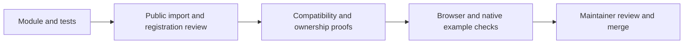
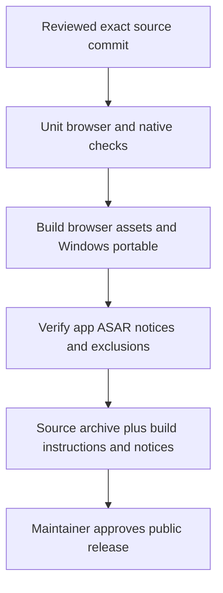

# Maintaining and releasing FourPataka

Monykus7 owns merges, API compatibility, license review and release decisions. Reviewed source contributions are welcome under GPL-3.0-only with compatible upstream notices. The owner selected this license on 2026-10-15. Copyright stays with authors; there is no assignment/CLA requirement. Keep LICENSE unmodified and project copyright separate from the Free Software Foundation's copyright on the license text.

## Support and API policy

The verified application baseline is v0.41.0 (both hosted jobs verified on720a97f; see implementation status) on Windows x64; current automation targets Node24, Ubuntu22.04 bundled Chromium and Windows2022 Electron. Windows11 local runs are evidence, not proof that hosted runners or other devices pass. Source requires Node22.12+. Other browsers, Linux/macOS native packages, mobile, physical listening and screen readers are not currently verified support targets. Automated tests cannot close those manual gates.

Public bundled-source APIs are numeric metadata, pedals, Fourier preset factories, synthesis engines and declarative features, exported by src/modules/index.ts; chord API1 remains its own boundary. Source services for virtual files are documented separately. Numeric API1 does not imply identical dataVersion/schemaVersion or compatibility with arbitrary callbacks. Keep IDs stable; data changes require explicit migration or visible preserved unavailable data. Do not silently reinterpret missing/newer module settings. There is no runtime loader or general React/theme/file/grammar adapter.

During 0.x development, document breaking API changes in the milestone plan, contributor guide and implementation status, with migration fixtures before merge. Prefer a deprecation notice for one implementation release before removal; an exception needs an explicit rationale and recovery path. Application versions, per-module API/data versions and project schema are separate clocks. Do not bump an application version for documentation/tooling changes alone.

## Contribution review



Verify tutorials against the actual public import and explicit assembly. Review units, finite bounds, copied state, phase/clock continuity, processor disposal, measured latency/tails, source spans/revision guards and live/WAV parity as applicable. Run boundary/registry/compatibility suites and the affected example workflows. Decline unexplained third-party code/assets or dependency licensing changes until their notices and rights are reviewed. Use CODE_OF_CONDUCT.md and SECURITY.md for reports; GitHub private vulnerability reporting is enabled; SECURITY.md links directly to the private advisory form. The maintainer must still respond and coordinate disclosure.

## Repeatable checks

A fresh checkout runs npm ci using package-lock.json. The Contributor checks workflow uses commit-pinned official actions, read-only contents permissions, no publication secrets and pull_request/push/workflow_dispatch triggers. Linux checks format, complete dependency notices, tracked private-file exclusions, all units, build, knowledge freshness and fifteen contributor browser suites with installed Playwright Chromium. Windows builds the portable, inspects the actual ASAR and runtime notices, and runs ten packaged startup/contributor workflows. Native profiles are isolated from user projects. Failed native runs retain generated test traces/profile artifacts for seven days; production user profiles are never used by these checks.

Reproduce source checks with the commands in CONTRIBUTING.md. On Windows, desktop:package first runs desktop:setup (Electron's own installer). A fresh npm ci provides the JavaScript package; it does not guarantee node_modules/electron/dist exists before electron-builder reads electronDist. The installer checks its pinned version/checksums and reuses an existing matching runtime. No blanket dependency-script approval is needed.

On Windows:

```powershell
npm run desktop:package
npm run distribution:check -- release/win-unpacked
$env:FOURPATAKA_TEST_EXECUTABLE=(Resolve-Path 'release/win-unpacked/FourPataka.exe').Path
npx playwright test --config playwright.desktop.config.ts --grep "one cache owner|desktop loads local assets|contributed level pedal|registered Fourier preset|independent engine edits|feature panels retain|packaged swing|packaged analysis|packaged phaser|packaged chorus"
```

CI artifacts are unsigned review builds retained for seven days on master pushes, paired with a source archive from the exact commit. They are not a public release or durable corresponding-source service. Logs/test profiles/model caches are excluded from upload. Repository controls were verified on 2026-10-18: master requires source-and-browser and windows-native with strict up-to-date checks; force pushes and branch deletion are blocked, and review conversations must be resolved. Administrator enforcement is intentionally off so the owner can keep pushing checkpoint commits. These pushes may report a visible administrator bypass while CI runs; that is not evidence of passing checks. Non-administrators must satisfy the required checks. Private vulnerability reporting is enabled. Runner availability and ongoing enforcement still require maintainer monitoring. Local pass results do not assert that hosted CI has run; record the actual run URL/result before closing that gate.

## Distribution and release



For an application release, record version, exact commit, artifact checksums and actual tests in IMPLEMENTATION_STATUS.md. Build the browser and native package from that commit/lockfile; preserve Electron's LICENSE.electron.txt and LICENSES.chromium.html. The browser root includes LICENSE.txt and THIRD_PARTY_LICENSES.txt; Windows ASAR also contains project LICENSE and THIRD_PARTY_NOTICES.md. Regenerate and review notices after dependency updates. The drift checker accepts reviewed MIT/ISC/OFL metadata, retains full upstream license text and fails unknown types; that is not a complete legal audit of changed assets or runtime components.

Provide exact corresponding source alongside a publicly distributed GPL binary, including lockfile, scripts, module sources, assets/notices and build instructions. Retain that source durably for the chosen distribution method; an expiring CI artifact is insufficient for a lasting release link. Verify source archives exclude private editor/agent files, caches, node_modules, personal data and build outputs. Do not offer a binary from an uncommitted working tree as a reproducible public release. Document signing/default-icon status and manual/device limits.

Download the paired assets from a successful Contributor checks run at the intended release commit. On Windows, run `node scripts/prepare-release.mjs <commit> <download-directory>` before uploading. It compares the complete source ZIP file list with that commit, checks every source file (only valid UTF-8 text may normalize checkout CRLF; binary bytes must match), rejects private/generated paths and writes SHA256SUMS.txt plus BUILDING.txt. It leaves the inspected source in a printed temporary directory. This verifies source correspondence and creates checksums; it does not authenticate an arbitrary executable or substitute for the successful packaged workflow. Publish the original CI executable and exact source archive together with these two files. Use [the reviewed release notes](releases/v0.39.0.md), an exact commit target and a pre-release tag. Verify uploaded asset hashes against the prepared files after publication; do not silently replace a published binary/source pair. GitHub Release assets are durable release distribution, unlike the seven-day CI artifacts. Keep tags and source available for every distributed binary.

Public release publication, repository visibility changes, npm/module publication, code signing, installation and future branch-protection changes are maintainer operations. The owner requested completion of M6 on 2026-10-18, including the configured protection/reporting settings and the verified contributor-preview release. The workflow creates no GitHub Release, package publication or installer. After a verified x.x.0 application release, open the portable normally without diagnostic stderr flags; repeat launches should focus the current profile owner. Tooling-only M6 work needs no app version bump or portable replacement.

M6 evidence is recorded in IMPLEMENTATION_STATUS.md. The clean-checkout tutorial is now a repeatable CI gate, with the [walkthrough](extensions/CONTRIBUTOR_WALKTHROUGH.md) and isolated npm ci/build/public-boundary/browser proofs. Repository controls and durable publication are verified: the [v0.39.0 contributor preview](https://github.com/Monykus7/FourPataka/releases/tag/v0.39.0) pairs original CI assets from commit49be138 with exact source and instructions. Both jobs pass in [run39085617326](https://github.com/Monykus7/FourPataka/actions/runs/39085617326); all four published asset digests and the exact tag target match. M6 is complete. M6 does not close physical listening/device/screen-reader gates or authorize arbitrary future package publication.

Hosted baseline: [run38802133636](https://github.com/Monykus7/FourPataka/actions/runs/38802133636) at commit41e841a passes source/browser and Windows portable/native/artifact jobs. This verifies the automated clean-checkout path; it does not complete the separate contributor tutorial, operational reporting or public-release gates.
