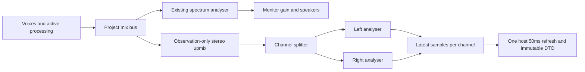
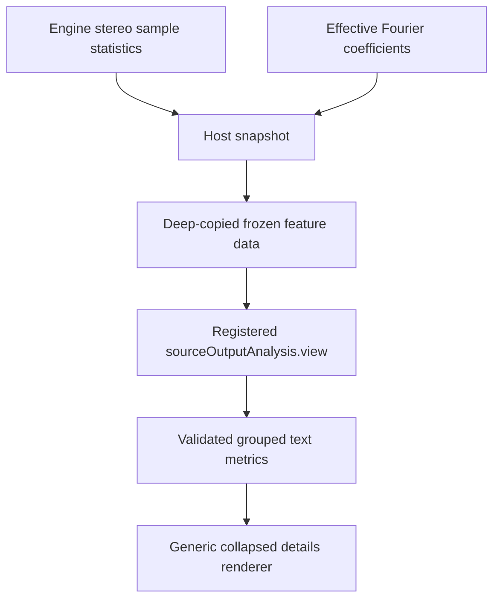
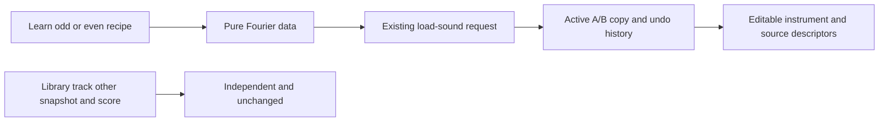

# Source and output analysis (v0.39.0)

Open Instrument and expand **Source / output analysis** below the main tools. It starts collapsed and can be hidden through Panels. Learn adds **Compare odd harmonics** and **Compare even harmonics** after the original four recipes. Loads use the existing undoable active A/B snapshot request; they do not replace the score, library, applied tracks or the other snapshot. No wizard locks the controls.

## Read the two sources of information separately

**Source model** describes the editable active A/B instrument at the displayed reference note, before output trim or envelope. Effective periodic components must be enabled and below Nyquist. Coefficient signs do not change their individual squared power. H1 belongs to the odd group and has its own contribution row. Odd + even + subharmonic shares total100% before display rounding when power exists; silence has no defined shares/centroid/dominant component. Dominant means the largest-magnitude effective component, not the highest frequency. Equal-magnitude ties retain the first component in harmonic/undertone order.

Let component amplitudes be a and frequencies f. Centroid is sum(f*a²)/sum(a²); mean-square steady-source power is sum(a²)/2, in amplitude². These are mathematical periodic-source descriptors, not watts, loudness or recording measurements. Non-Fourier engines show unavailable source descriptors while output metering remains available. Percussion descriptors explicitly exclude its noise, pitch sweep and decay, so the displayed periodic model is only part of a drum hit. Zero periodic coefficients do not imply that a noise hit is silent.

**Live output** observes active audition or the whole playing score after its processing/project mix, before monitor volume. It may contain many notes, owned sounds and effect tails; it is not necessarily the source model above. The panel identifies the path and warns when playing a frozen previous score. Editing current source text does not change that revision's applied instruments.

- RMS is sqrt(mean of the per-channel mean-square values).
- Sample peak is the maximum absolute sample across both measured channels.
- Levels use20*log10(amplitude), relative to full-scale amplitude1 (dBFS). Positive dBFS is retained rather than clipped by the meter.
- Crest factor is20*log10(peak/RMS), in dB. Silence omits undefined numeric levels/crest; Stopped and invalid/unavailable measurements are distinct states.

These are sample levels, not true peak, integrated loudness/LUFS, sound-pressure level or psychoacoustic classifications. There is no live output spectral centroid or peak-bin-frequency estimate in this release.

## Host graph and window

The observation branch duplicates mono into left/right rather than halving mono energy. It preserves separate stereo polarities; a mono downmix of opposite-polarity channels could otherwise falsely read zero. The audible graph, voice clocks, filters, latency alignment and WAV factories remain unchanged. The two analysers and buffers belong to the AudioEngine context, not individual panels; no extra module timer, listener or AudioContext is created. Stopped sessions report zero levels immediately; observation buffers remain bounded for context reuse.

Request round(sampleRate*0.1) samples per channel:4410 at44.1kHz and4800 at48kHz. Analyser FFT size is the next power of two, but only the latest requested samples are measured. Refresh is50ms, so100ms windows overlap. The implementation caps storage at32768 samples/channel and exposes actual window size/duration for unusually high sample rates. The initial window can contain zero-padded/startup or preceding bus samples; it is a moving bus measurement, not a recording summary. Readout refresh and window length are not an audio latency estimate.

[Web Audio specifies](https://www.w3.org/TR/webaudio-1.0/#AnalyserNode) that analyser outputs can remain unconnected. These taps do not need an audible path of their own.

## Contributor boundary

The module imports only src/modules/index.ts and registers once in assembly.ts. Additive API1 fields are optional: analysis.details contains evenShare/h1Share/meanSquare/dominantHz/dominantLabel/componentCount/partialModel; measurement adds channels and valid. Existing callbacks and settings remain valid. Existing modules remain compatible with the new host. Modules using grouped/collapsed views require host0.39.0 or newer: older renderers reject unsupported view fields. If a current host supplies a snapshot without detailed descriptors, the module shows unavailable states rather than invented values. No schema change: settings stay empty, visibility is a global preference, and collapse state is transient presentation rather than musical history.

FeatureView.metricGroups accepts up to8 titled groups of up to64 label/value pairs with an optional note; host validation rejects malformed/nonfinite executable data before React rendering. collapsedByDefault is optional boolean metadata. Existing flat metrics/cards/buttons continue working. Modules receive no audio nodes, arrays, transport setters or mutable project. The new analysis module exposes no actions.

The original square/triangle/missing-fundamental/undertone IDs and positions remain. New odd/even recipes use1/h magnitudes in their respective groups; they are not loudness matched. Loading the even recipe removes H1. Source descriptors can explain that change without asserting subjective timbre or perceived-pitch outcomes. Phase experiments remain deferred until phase controls exist.

## Verification and remaining limits

Unit checks cover known sine RMS/crest, DC/unequal/anti-phase channels, silence/invalid data and clipping, known source centroid/power/shares, Nyquist/undertone exclusions, unsupported/partial engines, recipes and bounded view metadata. Browser checks exercise real taps at44.1/48kHz, a muted downstream monitor, anti-phase cancellation in a separate mono analyser, correct latest100ms extraction after a level step, collapsed/narrow UI, ownership/undo/visibility/reload, stale score and unsupported engine labels. Native save/reopen preserves the experiment-owned sound; all runtime source and measurement data remain derived.

Existing comparison, feature and WAV suites guard clock/copy/audio behavior. Release evidence lives in IMPLEMENTATION_STATUS.md. These checks do not replace physical listening, full platform/browser/screen-reader testing or broader performance profiling. Microphone/file analysis, spectrograms, output spectral descriptors, true peak and LUFS are separate proposals.
