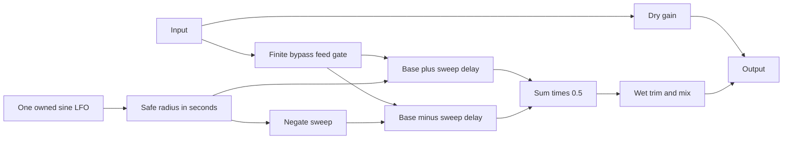
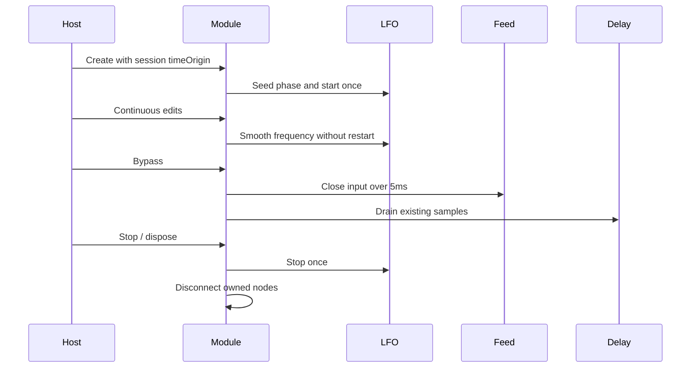
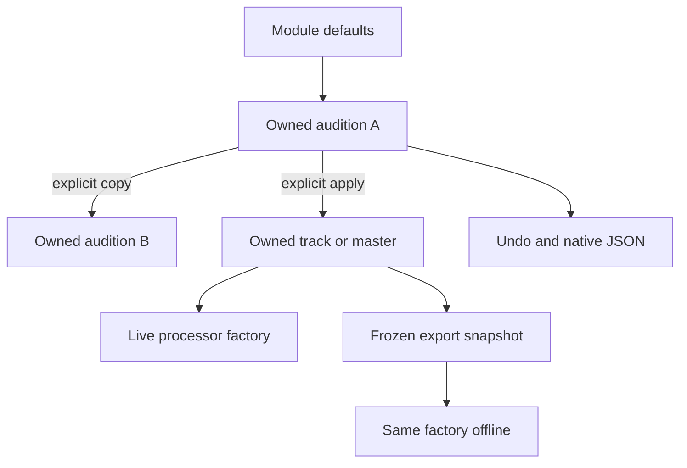

# Chorus module — v0.41.0

Chorus is a source-reviewed M2 contribution registered in assembly as `fourpataka:pedal/chorus`, API1/data1. Equipment, cables, controls, persistence and export discover it through the public contract. Schema5 projects keep their sound when the effect is absent. Older hosts preserve unavailable envelopes.

## Signal and controls

Two opposed sine-modulated delays share one oscillator and average their wet outputs. There is no feedback or extra stereo widening; stereo channels remain independent, and mono works normally. Rate is0.05–5Hz (default0.8), base delay5–30ms (15), depth0–100% (30), wet output−24…+12dB (0), mix0–100% (35). Reset creates owned defaults through ordinary undo history.

Depth is a percentage of a safe radius rather than the proposed independent millisecond control: `radiusMs = min(10, baseMs - 1) * depth / 100`. Defaults give±3ms around15ms. Every valid saved pair yields delays between1 and40ms. Base and radius share one automation timestamp and15ms smoothing constant, so convex interpolation preserves the causal lower bound during rapid edits.

With time in seconds, `wet(t) = 0.5 * (input(t-base-radius*sin(phase)) + input(t-base+radius*sin(phase)))`. Web Audio supplies delay interpolation. Mix is linear: `(1-m)*dry + m*dbGain(output)*wet`. At depth0 both voices become one base delay with unity wet gain. Output trim is not a limiter.

## Clock, drain and ownership

Optional environment timeOrigin uses AudioContext seconds: session.start live,0 in frozen WAV. A late branch seeds phase from current rate times session age, then retains its oscillator across edits. It does not reconstruct historical rate automation or another branch's delay history. After the short buffer warms, equal-rate branches match session phase. Running rate edits retain oscillator phase and the musical clock. Score edits retain the existing frozen-until-replay policy.

Bypass restores dry unity while closing wet input over a finite5ms ramp. At most40ms history plus interpolation margin clears within the50ms runtime/export budget at supported3–192kHz rates. Brief dry-plus-wet overlap is intentional. tailActive describes the scheduled bypass drain, not measured amplitude. Stop fades the session, then stops/disconnects owned sources and nodes; replay starts fresh. Repeated disposal is harmless.

Reported processing latency is0: this musical delay is intentional coloration, not alignment compensation. Both delays reserve50ms each. Declared estimates are12 owned nodes and192KiB state. Export budgets50ms when mix is nonzero and warns when the requested cap truncates it. The live and offline paths use the same factory with independently owned settings.

## Contributor verification

Start with the [module](../../src/modules/pedals/chorus.ts), [assembly](../../src/modules/assembly.ts) and [public contract](PEDAL_MODULES.md). Unit checks cover safe bounds, validation, defaults, independent JSON copies and resource/tail declarations. Browser renders compare static delay/gain/dry bypass and an independent moving-delay formula, preserve stereo channels, and test finite extreme-rate tails, rapid causal edits, drain timing, late-branch phase and source cleanup. Live engine checks retain the clock during edits and warmed topology replacement; WAV matches the direct module at44.1/48kHz and resists edits after export starts.

Board workflows exercise dragging/cables, dials/exact values, reset/undo, A/B/master copies and reload at wide/390px layouts. The packaged workflow additionally tests Listen/Stop and native save/reopen. Executed results and hashes belong in [implementation status](../../IMPLEMENTATION_STATUS.md). Adding a test alone is not a passing result. Physical listening, device latency and broader accessibility remain separate checks.
