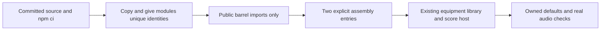
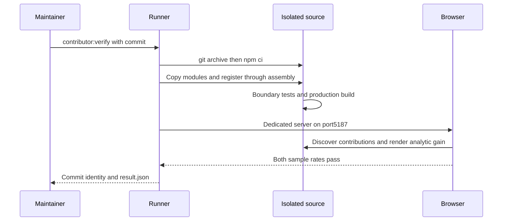

# Build your first contributions from a clean checkout

This walkthrough exercises the supported pedal and Fourier-preset boundaries. All modules are reviewed TypeScript bundled at build time. Song files cannot install code. Contributions are GPL-3.0-only; retain author and compatible upstream notices.

## Prerequisites

Clone the public repository and use Node24 (minimum22.12). Run `npm ci`. Install a test browser with `npx playwright install chromium` and set `PLAYWRIGHT_BUNDLED_CHROMIUM=1` in your shell. On Linux, `npx playwright install --with-deps chromium` also prepares system libraries. No Visual Studio, private agent files, model download, credentials or personal scores are needed.

## Make two small modules

1. Copy `src/modules/examples/level` to `src/modules/examples/tutorialLevel`. Keep its sole import from `../../index`, the public module barrel. Rename `levelPedal` to `tutorialLevel`, change its ID to `tutorial:pedal/level`, and label it `Tutorial level`. Give your real contribution your own namespace and author/attribution.
2. Copy `src/modules/examples/mellowPluck` to `src/modules/examples/tutorialPluck`. Rename `mellowPluck` to `tutorialPluck`, set ID `tutorial:instrument/pluck`, library ID `tutorial-pluck`, score key `tutorialPluck`, and label `Tutorial pluck`. The factory returns independently owned sound data; it does not add a scheduler or a new synthesis algorithm.
3. In `src/modules/assembly.ts`, import the two new exports. Add `tutorialLevel` to `definitions` and `tutorialPluck` to the first array passed to `createFourierPresetRegistry`. Leave reserved built-in lists unchanged. These are the only host registration changes.
4. Run `npm run dev`. In a fresh project, find **Tutorial pluck** in the library and **Tutorial level** in **Pedalboard → Equipment**. An existing project needs **Add bundled presets** to discover the new preset. Place and cable the pedal using the normal interface. Use `track test using tutorialPluck {` with note lines and a closing brace in Compose.
5. Run `npm test -- tests/unit/moduleBoundaries.test.ts`, `npm run build`, and your new module tests. Test fresh default copies, malformed settings and duplicates, actual DSP at44.1/48kHz, live/WAV parity, disposal/Stop and saved-data behavior. Registration is not proof of audio quality. Follow the detailed [pedal](PEDAL_MODULES.md) and [preset](FOURIER_PRESETS.md) guides before submitting a real contribution.



## Reproduce the automated exercise

Before changing your working source, run:

```sh
npm run contributor:verify
```

The command exports committed `HEAD` into a newly created temporary directory, installs dependencies there with `npm ci`, performs the two copies/identity edits and assembly registrations above, and copies the verification fixtures from `scripts/contributor`. It runs public-boundary/copy checks, the production TypeScript build and an actual browser that discovers both additions and measures the Level transfer function at44.1/48kHz. The browser uses a dedicated port5187 and refuses to reuse an existing server. Your working app/project stays separate.

An optional commit argument, `npm run contributor:verify -- <commit>`, selects committed source. Uncommitted changes are deliberately excluded. The runner itself and its test fixtures come from your current checkout; the printed source commit identifies the exported application. This is an integration exercise, not an independent human usability study or a security sandbox.

The exported tree and `result.json` remain in the printed temporary directory for inspection. The result is written only after every step passes; failures stop immediately and print the failing command. Remove the specific temporary folder yourself when finished. The script does not delete unrelated files or upload source/results. The two tutorial modules never enter the normal application assembly.



Linux contributor CI runs this same exercise after installing Chromium. Windows CI separately verifies the packaged application and bundled contributor examples, including native JSON save/reopen. This exercise does not claim screen-reader, listening, device CPU or arbitrary third-party module safety validation.
