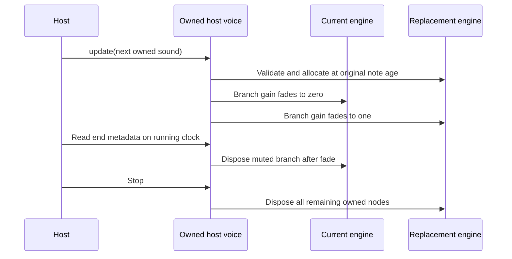
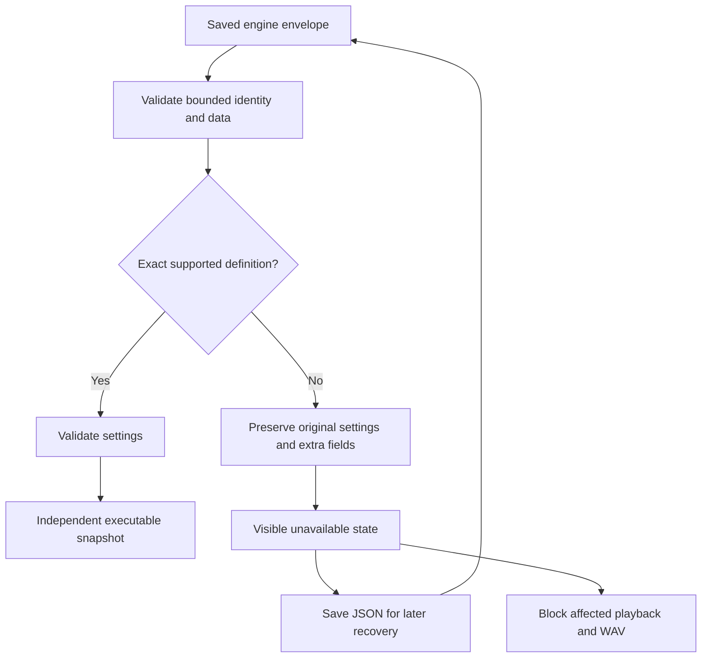

# Synthesis engines: public API and application integration

M4a voice contracts shipped in v0.35.0. M4b application integration ships in v0.36.0: choose Basic Tone in Instrument, edit its exact controls, Save as new with a score key, Apply owned track copies, compare on the running clock and save/reload/export through the shared factory. This is reviewed bundled source, not a runtime installer. Licensing and contributor CI/publication remain M6 work.

## Use an independent instrument

1. In Instrument, select **Basic Tone** in **Synthesis engine**. Switching creates fresh defaults in the active A/B snapshot; it does not overwrite the library or tracks.
2. Edit Attack/Release (seconds), Output trim (dB) and Detune (cents). Exact numbers and sliders share validation and grouped undo. Fourier dots, coefficients, undertones, macros and partial solo are absent for this engine.
3. **Save as new** adds a library instrument with your own name and unique score key. **Save preset** updates the selected template only. Use `track lead using myTone { C4 quarter }` in Compose after creating `myTone`.
4. Existing tracks retain independent settings until **Apply to lead** or the explicit all-associated-tracks action. Library, track and A/B copies never share mutable settings. Folders work for engine instruments too.
5. Listen/Play/Stop, autosave/import/recovery/native JSON and WAV use the same engine factory. A/B on a running audition or selected score track changes the sound while the transport keeps advancing. Replay is explicit.

## Add your engine

Read [Basic Tone](../../src/modules/examples/basicTone/index.ts), [public exports](../../src/modules/index.ts), [contract](../../src/modules/foundation/engines.ts), [saved sound adapter](../../src/core/engineSound.ts) and [assembly](../../src/modules/assembly.ts).

Copy the example into a module folder and import only `../../index`. Use an owned `name:engine/tone` ID; `fourpataka:` is reserved. Register the definition once in `engineModules`. The selector and numeric controls derive from the registry; no App/parser/scheduler/WAV case is needed for another supported numeric-settings engine. A score key belongs to a saved library instrument, not to a module ID.

Definitions include API/data versions, label/author/attribution, sample-rate range, live/offline support, randomness, capabilities, resource estimates, optional numeric `parameters`, `releaseSeconds(settings)`, defaults, validation and factory. Public API remains experimental API1; M4b extends the earlier M4a contract with release/control/zero-latency declarations. There were no saved independent-engine projects in schema3.

Controls use NumericParameter metadata: label/description, min/max/step, explicit unit/default and update mode. Declared defaults must match settings; metadata is validated and frozen. A settings key can be exposed without private host imports. This first editor supports flat numeric controls; nested/custom panels require a later reviewed editor extension. A non-Fourier engine must declare Fourier/dot/partial-solo capabilities false. Fourier continues its existing editor and data format.

The current application supports engines with live and offline factories, phase-continuous updates and **zero declared processing latency**. Replay-only/live-only/offline-only definitions may be used by dedicated code harnesses but are excluded from application selection. Nonzero engine latency is rejected until a compensation contract exists. Processing pedals retain their separate latency/tail alignment. Do not label an algorithm zero-latency if it buffers output.

Validate settings without mutating input, before allocation. The wrapper captures callbacks/metadata and validates copied bounded JSON: depth≤8, arrays/records≤128 entries, strings≤4096 characters, keys≤160, finite numbers/booleans/null/plain records; prototype-like keys are rejected. Fresh defaults and update snapshots are independent. Reviewed callbacks are trusted source, not a security sandbox. Clean up partial allocations before throwing.


## Time, phase and cleanup

`EngineNote` supplies context/destination/settings, frequencyHz, startSeconds, durationSeconds, optional releaseLimitSeconds, optional solo and unsigned32-bit seed. Times are on the audio-context clock. Host tempo/articulation/tuplets convert score beats to seconds first. Note-off is start plus gate duration; a release limit caps the release portion. `releaseSeconds(settings)` reports a finite0–10 second release budget for live duration/offline preflight. `end` reports expected silence, updated after envelope edits or retirement; pedal tails are separate.

The host owns transport,32-voice admission, look-ahead, frozen export revisions, copies/history, routing, monitor/mix and native privileges. An engine owns its nodes/buffers/callbacks. `update` preserves original note-off and phase; `steal(atSeconds)` schedules a short retirement; `dispose` stops future/active sources, clears callbacks and disconnects nodes idempotently. Natural completion also releases nodes. A silent voice may have no oscillator callback, so host end-metadata cleanup remains necessary.

Same-engine Fourier edits preserve original phase-rotated20 ms crossfades, integrated hit sweep, undertones, trim and fixed-seed noise. Basic Tone retains its native oscillator for detune/trim edits; attack/release edits modify the remaining envelope with planned-gain anchors rather than reading a future AudioParam.value.

Cross-engine changes allocate a replacement before touching the old branch, preserve the original start/gate and crossfade branch gains over20 ms. Basic Tone seeds its sine phase from original note age when joining an already-running note. Fourier uses its existing integrated phase rotation. These policies keep common-tone comparison continuous; unrelated algorithms need their own meaningful age/phase initialization. No new score clock starts and no applied project sound is overwritten.

Muted branches remain owned until the host reads end metadata after their fade; those reads collect them. Stop disposes every branch, including future/retired sources. At most eight transient branches per host voice are retained during unusually rapid cross-engine changes; older muted transitions are disposed when that bound is exceeded. Offline rendering creates the saved engine directly and shares its lifecycle, not a second approximation.



## Schema4 and unavailable recovery

Current sounds are a union, not synthetic Fourier arrays for every algorithm:

```ts
// Legacy FourierSound remains the original flat32-coefficient object.
const sound = {
  engine: {
    id: 'example:engine/basic-tone',
    apiVersion: 1,
    dataVersion: 1,
    settings: { attack: 0.015, release: 0.25, trim: -12, detune: 0 },
  },
};
```

Schema4 imports schemas1/2/3. Schema1 owned Fourier banks are padded independently; other legacy coefficients/signs/envelopes/keys/source/processing/folders stay intact under the existing conservative factory rules. Storage keys stay stable. Engine envelopes are rejected in older schemas rather than silently treated as Fourier data. Original user demo source remains unchanged.

Only exact available API/data versions execute. Bounded missing/newer engine payloads preserve settings and extra engine/source fields and receive a visible unavailable marker. Selection does not substitute a sine. Affected audible tracks, audition or WAV fail clearly; unrelated library items can still be retained/saved. Reimporting when an exact compatible definition is registered revalidates settings and removes the marker. Malformed data and invalid exact-version settings reject import atomically. No arbitrary settings-version migration callback or executable installation from project JSON is provided.

Choosing another engine replaces only the active snapshot with reviewed defaults; explicit Save/Apply is still required to replace unavailable library/track copies. Saving JSON preserves unavailable settings for recovery. Do not overwrite their version or guess a conversion.



## Resource, randomness and proof limits

Basic Tone allocates an oscillator and two gains; the host adds a branch gain. Fourier has steady-voice estimates plus shared one-second noise storage at its maximum rate. Transient edits can exceed steady estimates. WAV preflight includes pedal estimates and32 times the largest routed engine node/buffer estimate, conservatively overcounting shared buffers; reject totals beyond4096 nodes/128 MiB before graph allocation. This is admission/estimate policy, not measured device CPU or an isolation guarantee.

Both bundled engines support context rates3000–384000 Hz; automated tests exercise44.1/48 kHz. Fourier excludes unavailable partials at/above Nyquist without erasing saved coefficients. Basic Tone uses a sine, with detune in cents; contributors own aliasing policy. Basic Tone randomness is none. Fourier retains deterministic fixed-seed shared noise, not the note seed. A seeded algorithm must use the supplied seed and prove reproducible offline output.

Optional envelope/oscillator ports are diagnostics; new algorithms need not implement them. Existing Fourier diagnostics stay available. Physical listening, device latency/practical polyphony and wider CPU/memory profiling remain open; automation does not establish exact perceptual fidelity or all-device performance.

```sh
npm ci
npx vitest run tests/unit/engineModules.test.ts tests/unit/engineSound.test.ts tests/unit/moduleBoundaries.test.ts
npx playwright test tests/browser/engine-instruments.spec.ts tests/browser/engines.spec.ts tests/browser/audio.spec.ts
npm run build
npm run test:desktop -- --grep "independent engine"
```

The [browser harness](../../tests/browser/engine-instruments.spec.ts) covers editor/library/Apply/reload, cross-engine continuity and deterministic frozen WAV at both export rates; [native tests](../../tests/desktop/app.spec.ts) cover portable app selection and native JSON. See [build plan](../../BUILD_PLAN.md) and [implementation status](../../IMPLEMENTATION_STATUS.md) for actual release evidence and remaining gates. The planned WAV-to-instrument analysis and instrument chamber are separate features.
