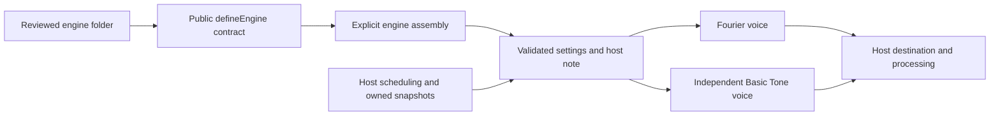
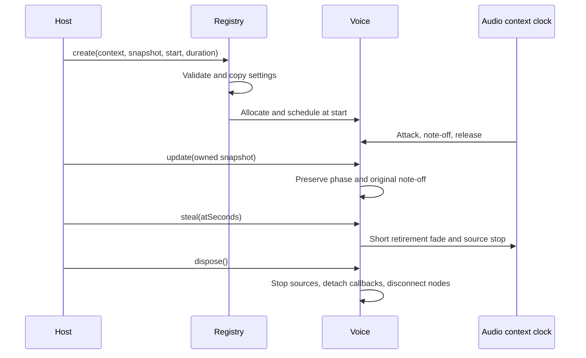
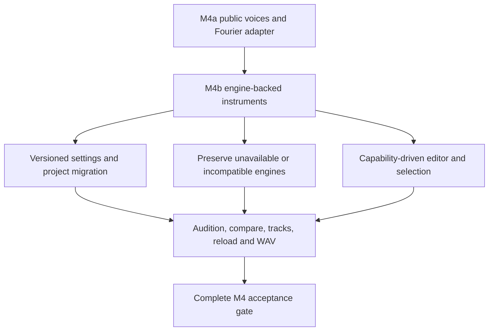

# Synthesis engine foundation (M4a)

Implemented in v0.35.0, API version 1. The existing Fourier voice now runs through a public engine contract. Basic Tone is an independent, registered native-oscillator example with its own settings. This is a source contribution API, not a runtime installer.

**M4 is not complete.** Basic Tone is available to code and the test harness; it is not yet a selectable library instrument or a score key. M4b will add engine-backed instrument data, migration/unavailable-engine recovery, suitable controls and comparison. Schema 3 continues to save only existing Fourier sounds. Do not insert engine IDs/settings into those projects yet.

## Start with the runnable example

Read [Basic Tone](../../src/modules/examples/basicTone/index.ts), [public exports](../../src/modules/index.ts), [contract](../../src/modules/foundation/engines.ts) and [assembly](../../src/modules/assembly.ts). Engine contributors import only the public barrel. The boundary test rejects private host imports and cycles.

1. Copy `src/modules/examples/basicTone/index.ts` into your own module folder. Use an owned namespaced ID such as `your-name:engine/tone`; `fourpataka:` is reserved for allowlisted built-ins.
2. Define plain settings and defaults. Include API/data versions, attribution, sample-rate range, live/offline support, randomness, capabilities and resource estimates.
3. Validate every field without mutating the supplied settings, and reject unsupported values before allocating nodes. Settings are bounded JSON: finite numbers, booleans, null, bounded strings, arrays and plain records. Limit depth to eight, arrays/records to 128 entries, strings to 4096 characters and keys to 160; prototype-like keys are rejected.
4. Implement `create`, returning `end`, `update`, `steal` and `dispose`. Never create an AudioContext or a transport timer inside a voice.
5. Import your definition in assembly and add it to `engineModules`. Do not add a parser/scheduler switch. Registration enables public factory lookup; application selection and persistence are separate M4b work.
6. Add unit and browser proofs for your algorithm. The checked-in example is tested by the commands below.

```sh
npm ci
npx vitest run tests/unit/engineModules.test.ts tests/unit/moduleBoundaries.test.ts
npx playwright test tests/browser/engines.spec.ts tests/browser/audio.spec.ts
npm run build
```

The browser proof supplies real AudioContext/OfflineAudioContext objects and imports assembly. To render a registered engine from development code:

```ts
import { engineModules } from './src/modules/assembly';

const definition = engineModules.get('example:engine/basic-tone');
const context = new OfflineAudioContext(1, 48000, 48000);
const voice = definition.create({
  context,
  destination: context.destination,
  settings: definition.defaults(),
  frequencyHz: 440,
  startSeconds: 0.05,
  durationSeconds: 0.5,
  releaseLimitSeconds: 0.1,
  seed: 0,
});
const buffer = await context.startRendering();
voice.dispose(); // Idempotent after natural completion too.
```

The import above is for a harness at repository root. A module implementation uses `../../index`, as the checked-in example does. A consumer uses host assembly to choose a definition; a contribution never imports assembly. The resulting AudioBuffer can be used by a developer's export harness. This does not add a Basic Tone option to the application's WAV dialog.



## Clock and ownership contract

`EngineNote` contains the host's context and destination, owned settings, `frequencyHz`, `startSeconds`, `durationSeconds`, optional `releaseLimitSeconds`, optional partial solo and an unsigned 32-bit `seed`. Times are seconds on the context clock, not score beats, milliseconds or wall time. The host converts score tempo/articulation/tuplets first. Duration is the note gate; note-off is start plus duration. A release limit caps the release portion, not the full note duration.

`end` is the current audio time when the voice is expected to be silent. Expose a getter if edits or retirement change it. Account for release; do not count processing-chain tails here. Existing pedals and the host own processing latency/tails. Both supplied engines have zero intentional processing latency; the contract has no generalized engine-latency compensation yet.

The wrapper clones settings at creation and update, validates before calling the implementation, captures metadata/callbacks, freezes registry metadata and returns independent defaults. This prevents caller edits to a library/track/A-B object from changing a live voice behind the host's back. Modules must still keep their own internal state independent. Function code is reviewed trusted source; the API is not an isolation or security sandbox.

The host retains transport clocks, 32-voice admission, look-ahead scheduling, frozen export revisions, track/A-B/library copy ownership, routing, monitor/mix, Stop and native file privileges. Engines own every node, buffer and callback they allocate. An allocation failure must clean up anything already created before throwing.



`update` must obey its declared mode. `phase-continuous` keeps the original note origin and accumulated oscillator phase; edits cannot replay the note. Basic Tone retains its oscillator and smooths detune/trim over a 10 ms time constant. Attack/release edits adjust the remaining envelope around the original note-off. Fourier continues its existing phase-rotated 20 ms source crossfades, integrated pitch sweep, undertones and percussion envelopes.

A `replay` definition explicitly rejects in-place updates. A future host UI must offer deliberate replay for that capability; it must not silently reset the transport. Both bundled definitions support phase-continuous updates.

`steal(atSeconds)` schedules retirement at the supplied audio time, including future notes created during look-ahead. Both examples hold the scheduled envelope, fade over 10 ms, report end at `at + 0.01` and stop oscillators by `at + 0.015`. Do not use `AudioParam.value` as a substitute for a future scheduled envelope.

`dispose()` is immediate, idempotent and owns future sources too. Clear callbacks and disconnect nodes; natural `onended` completion also cleans up. A silent Fourier voice may have no oscillators, so host cleanup must use end metadata rather than relying solely on an oscillator callback. No timer/listener/device subscription may survive disposal.

## Capabilities and algorithm details

Fourier declares Fourier inspection, dot editing and partial solo. Basic Tone declares none of these; its independent settings are attack (0.005–2 seconds), release (0.01–3 seconds), output trim (−36–0 dB) and detune (−1200–1200 cents). Defaults are 0.015 seconds, 0.25 seconds, −12 dB and zero cents. Its waveform is a native sine; it does not translate settings into 32 partial arrays.

Definitions must support at least one of live/offline. The wrapper detects offline contexts, rejects unsupported modes/rates and validates frequency, timing and seed before allocation. Both bundled engines declare 3000–384000 Hz context rates; this is a supported range, not evidence that every rate/device was measured. Host pitch is in Hz. Fourier omits unavailable partials at or above Nyquist without erasing saved coefficients. Contributors are responsible for their algorithm's aliasing policy.

Randomness modes are `none`, `fixed` or `seeded`. Basic Tone uses none. Fourier retains its existing deterministic fixed-seed noise buffer shared per context, preserving drum timbres; it does not use the note seed. A seeded contribution must use the supplied seed, never Math.random/time, and prove identical offline renders for identical input. Offline proof is repeatability, not perceptual validation.

Resource fields are **estimates**, not enforced node allocation or CPU limits. Basic Tone allocates one oscillator and two gains. Fourier reports a conservative steady-voice estimate and shared one-second noise storage at its maximum rate; rapid edit crossfades can temporarily exceed steady-state node counts. The host's voice cap is unchanged. M4b still needs whole-engine CPU/memory budgets and profiling across supported devices. Do not claim a hard memory/CPU bound from metadata alone.

Optional `envelope` and `oscillators` ports are diagnostic aids. New algorithms do not have to expose them. Only the legacy Fourier compatibility adapter requires those ports so existing host diagnostics/tests continue working.

## Persistence is the next gate



Current schema-3 library, tracks and A/B still hold independent FourierSound values. Engine `dataVersion` is declared for future compatibility; no engine saved-data migrator is shipped here. An unavailable engine lookup fails clearly in code, but this is not project recovery. M4b must preserve unavailable settings losslessly and explain disabled playback before adding selectable saved engines. It must migrate existing projects without changing Fourier sounds or the authored demo.

Required next proofs: independent-engine library/track/A-B audition and continuous comparison; Stop/replay; save/reload and unavailable/incompatible recovery; offline WAV through the app; suitable editor capabilities; budget/latency decisions. Licensing, runtime loading and contributor CI/publication remain separate M6 gates.

See [engine contract unit checks](../../tests/unit/engineModules.test.ts), [real audio harness](../../tests/browser/engines.spec.ts), [Fourier regression proofs](../../tests/browser/audio.spec.ts), [build plan](../../BUILD_PLAN.md) and [implementation status](../../IMPLEMENTATION_STATUS.md). Browser measurements and native smoke checks are automated evidence; physical listening, device latency and practical polyphony remain manual gates.
