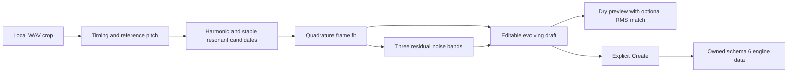
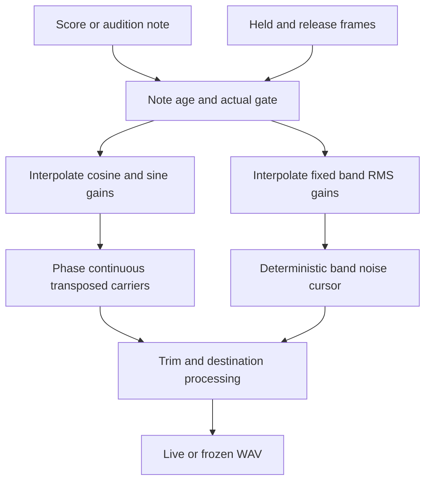

# W2 evolving spectrum instruments

Open **Instrument Library → Import WAV** and choose **Evolving spectrum (W2)**. Use a crop containing one isolated note or hit. Review the pitch, detected timing, tonal and noise envelopes, and audition the source and reconstruction. Mark note-off when it is known. Edit global gain, contour speed, release or individual frames before creating the preset. The Instrument editor can edit the same frames after creation.

A saved preset can be selected in Instrument, copied between A and B, applied to tracks or called by its key in a score. An A/B edit is independent of the library and existing tracks. **Reset engine controls** resets the five global controls and keeps the fitted frames. Import and audition use the local file only during review. Saved settings carry the sound into playback and WAV export.

## Model and units

- The worker inherits W1 bounds of 32 MiB, 30 seconds, mono/stereo 8–96 kHz and an 8-second crop. Detection permits a short automatic body for transient hits. Manual body bounds remain 35–500 ms. The reference Hz may be overridden. With weak periodicity the UI reports no stable fundamental and uses an A3 playback reference for any detected resonances.
- Early, body and tail windows fit a shared set of up to 24 tonal lanes chosen by peak amplitude from H1–H32 and up to three off-series resonances. Modal candidates need sharp peaks in two windows. A manual or estimated pitch sets harmonic ratios. Resonance ratios use the same reference and transpose with the note. Residual noise bands stay fixed in Hz. Frequency estimates and sparse frames can blur rapid vibrato, pitch sweeps or closely spaced resonances.
- Each tone's cosine/sine pair is a signed linear amplitude at one time. Projection uses the same phase origin from onset in every window. Each frame stores three nonnegative residual RMS levels from a split at 750 and 3500 Hz with first-order filters. This approximates broadband and transient energy. Deterministic generated noise has a different waveform from the source noise. Overlapping bands can give a different total RMS, so audition with RMS matching when comparing the timbre.
- Held frame times are elapsed seconds, up to 8 seconds. The contour speed multiplier advances the held clock and the last frame holds on a sustained note. Release frame positions are fractions of the selected release duration, from zero to one. Without known note-off the captured decay is part of the held contour and the release default is 60 ms. The reconstruction plot estimates the tone and noise envelopes. It summarizes the fitted bands and does not measure perceptual similarity.
- Global tone/noise gains are linear and trim is in dB. Import attenuates the fitted draft when the maximum summed tonal amplitude plus five times the sum of band RMS estimates exceeds 0.9. This estimate leaves headroom for typical noise peaks. Preview also applies its measured peak protection and optional RMS matching. Manual frame edits can raise the saved output level.

## Voice lifecycle and recovery

`fourpataka:engine/spectral` uses M4 engine API 1/data 1. It serializes ordinary bounded JSON in the existing schema 6 engine envelope. Older installations preserve unavailable engine payloads through the existing recovery path. There is no original audio, recording path or installed module requirement beyond the bundled engine.

The renderer uses a pair of fixed-phase oscillators per tone. Linear interpolation of both gains passes through zero smoothly during a phase reversal. Frequencies above the playback Nyquist are muted. A replacement voice uses the original note age to place the carrier phase and noise cursor. Same-engine edits reschedule gain from the current audio-clock level and retune carrier pairs without restarting them. The release curve is corrected to meet the actual gate amplitude, with that correction fading to zero. Voice stealing fades the output and stops the sources.

The engine has zero alignment latency. One voice owns at most 103 nodes, including both carriers/gains, a three-channel noise source and splitter, three noise gains, trim and output. The one-second seeded buffer is shared per context. The host budget conservatively charges its maximum size plus scheduling overhead per voice. Normal and offline synthesis use the same factory. Instrument acoustics and downstream pedals remain separate.

The regression fixtures test evolving partials, phase, modal retention, short noise hits, transposition, live updates, deterministic output, release and Stop. Browser and native workflows test preset ownership and WAV export. Perceptual listening on recorded instruments remains a separate check.
