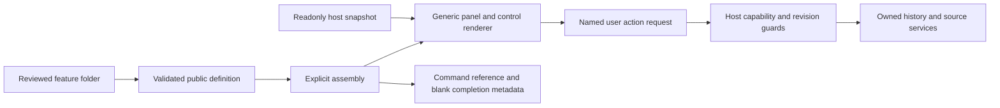
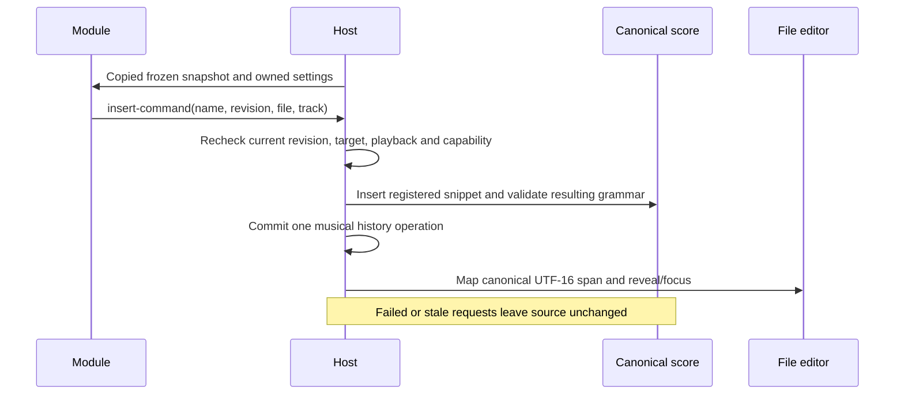
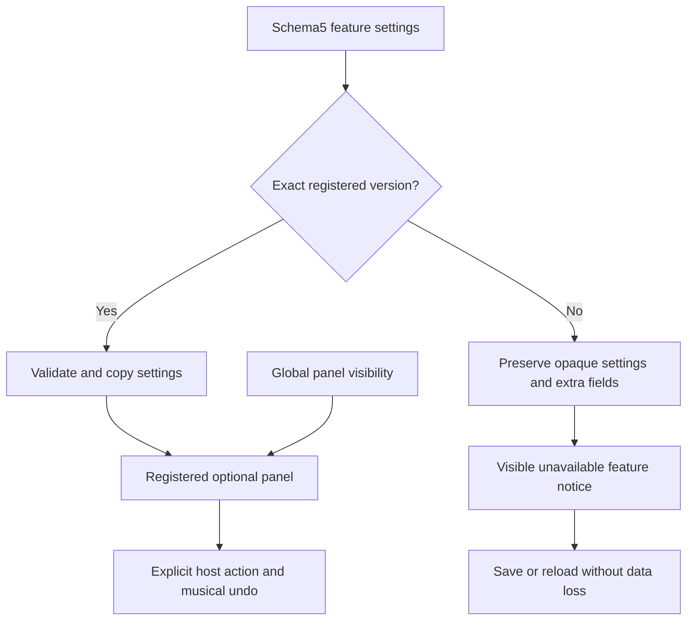

# Feature modules and host workflow services

Implemented in v0.37.0, experimental public API1. Reviewed source definitions register declarative panels, learning actions and command-reference/completion metadata. The host renders them at fixed placements; a contribution needs a module folder and one assembly entry, with no per-module App view switch. There is no runtime installer or executable code in project files.

The built-in **Fourier source** module replaces the former root Learn implementation, preserving square, triangle, missing-fundamental and undertone experiments plus steady source descriptors. **Partial pair** is an independent example: adjustable saved H2 recipe, explicit owned-snapshot loading, live output peak/RMS and an octave-pair command card using existing explicit-chord syntax.

## Use the panels

Open Learn. Panels checkboxes hide/show registered modules; this is a global preference, not a musical undo operation. Hidden modules retain their project settings. Other fixed placements are Instrument, Compose and Pedalboard, below their existing workspace; host navigation keeps its current prominence.

Partial pair's H2 slider/exact number edits the saved experiment recipe. **Load partial pair** applies it to the active A/B snapshot, opens Instrument and creates one undo operation. Library, applied tracks, source and the other A/B side remain unchanged. Save/Apply in Instrument remain explicit. Original experiments behave the same way; the undertone experiment opens its bank.

**Insert octave pair** inserts a registered filled reference snippet into the selected Compose file/track, only while source is valid and score playback is stopped. It opens Compose, selects/reveals the inserted source and focuses the editor. Undo restores canonical source. The command reference also discovers the card; completion contains blank note/duration fields, not fixed pitches.

## Copy the runnable contribution

Read [Partial pair](../../src/modules/examples/partialPair/index.ts), [public exports](../../src/modules/index.ts), [contract](../../src/modules/foundation/features.ts), [assembly](../../src/modules/assembly.ts), [host data/guards](../../src/core/featureHost.ts) and [renderer](../../src/components/FeaturePanels.tsx).

1. Create a module folder and import only the public barrel (`../../index` in this example). Use an owned `name:feature/tool` ID; `fourpataka:` is reserved for allowlisted built-ins.
2. Declare API/data versions, label, author/attribution, one placement and needed capabilities. Capabilities are `instrument`, `source` and `measurement`; request only those your feature uses.
3. Define pure defaults and settings validation. Optional NumericParameter metadata supplies flat sliders/exact controls with bounds, units, defaults and update labels. Defaults must match actual settings. Settings cannot contain nodes/functions/nonfinite data.
4. Implement a pure synchronous `view(snapshot, settings)` returning text, cards, metrics and named buttons. This first API is declarative; arbitrary React panels, custom controls/styles, dialogs, file handlers and theme registration are not implemented by it. All text renders through React text nodes.
5. Implement `action(id, snapshot, settings)` returning a supported host request. Do not mutate the project or create timers/AudioContexts/listeners in either callback. The host owns side effects, focus, history and audio.
6. Optionally declare track-scoped command metadata describing existing grammar. Add one definition to `featureModules` in assembly. The renderer, controls and command lists discover it; no parser replacement or root module branch is needed.
7. Add unit/browser/native proof as appropriate. Remove the assembly entry to remove the panel/cards; keep unknown saved data for later recovery.

```sh
npm ci
npx vitest run tests/unit/featureModules.test.ts tests/unit/moduleBoundaries.test.ts
npx playwright test tests/browser/feature-modules.spec.ts
npm run build
npm run test:desktop -- --grep "feature panels"
```



## Read-only snapshot API

The snapshot is copied and deeply frozen before the module receives it; settings are copied too. It contains no mutable Project, file handle, AudioNode, transport setter or complete score text.

- `sourceRevision`: monotonically advancing host revision when canonical source changes, including undo/import. UI-only selections do not advance it.
- `targetTrack`, `targetFile`, `sourceEditable`: current insertion destination and source/playing guard. A changed file/track invalidates an old source request even if the text revision is unchanged.
- `referenceNote`, `analysis`: current source's supported flag, coefficient power, centroidHz and odd/subharmonic power fractions. Fourier calculations account for reference pitch and Nyquist availability, before trim/envelope. Silence has zero power/null centroid; non-Fourier engines are unsupported, not falsely silent.
- `measurement`: sample peak/RMS linear amplitudes, sampleRateHz, windowSamples, cadenceMs, playing/mode, positionSeconds and staleScore. `staleScore` identifies output from a frozen earlier score while the editor has changed.

Measurement uses the existing host analyser:2048 samples, refreshed50 ms, after the active processing path/project mix and before monitor volume. At48 kHz the window is42.7 ms; at44.1 kHz it is46.4 ms. Convert amplitude with20·log10(value); zero is−∞ dBFS. Sample peak is not true peak, RMS is not LUFS, and a short moving window is not a complete-recording analysis. Stopped is distinct from running silence. Features share one sampled buffer per host tick and allocate no extra analyser or audio subscription.

Keep callbacks cheap: model refresh may follow the host50 ms cadence. Source analysis is memoized by sound/reference/sample rate; full score text is not copied every tick. Declared callbacks are trusted reviewed code, not a security sandbox. Public import-boundary/cycle checks and shape validation catch integration mistakes; they do not isolate arbitrary executable code.

## Supported host requests

`open-instrument` changes the host view. `load-sound` supplies validated FourierSound and optional openUndertones; the host clones it into the active snapshot and owns one undoable transaction. It does not apply library/track copies or silently replay transport. Existing live comparison keeps its clock/phase policy.

`insert-command` supplies a registered command name, expectedRevision and the captured targetTrack/targetFile. The host rechecks capability, revision, destination and actual score playback, resolves the current source spans, inserts with existing source services, and parses the result before committing. Invalid grammar leaves source/history unchanged. The host computes canonical UTF-16 insertion spans and the editor maps them into its file projection, selects/reveals the text and focuses it. One-shot navigation checks the expected source text, so later edits/undo cannot reveal a stale span.



Command cards carry name/group/track scope/description/snippet/completionTemplate/syntax/rules. Names must be unique across feature and built-in cards. The reference snippet can be a concrete example; completion must provide appropriate editable shells. The API describes existing parser semantics; new grammar still needs a reviewed parser/compiler change with precedence/recovery/live-WAV proof. Initial feature cards are track-scoped; project directives/new-track handlers remain existing host commands.

## Project settings, preferences and recovery

Schema5 adds optional `featureSettings` keyed by feature ID. Each entry has API/data versions and settings. All settings changes validate and copy before a grouped host history transaction. Partial pair's H2 value is a musical experiment recipe; it is saved in the project. Panel visibility remains global preferences and project import never replaces it. Storage keys stay stable.

```ts
featureSettings: {
  'example:feature/partial-pair': {
    apiVersion: 1,
    dataVersion: 1,
    settings: { h2: 0.6 },
  },
}
```

Import1–4 preserves existing source/sounds/chains/folders/files and engine recovery; schema1 retains its independent harmonic padding. Feature envelopes are rejected in earlier schemas rather than silently discarded. Exact available versions validate; malformed/exact-invalid data reject import atomically. Bounded missing/newer payloads preserve their settings and extra fields and display an unavailable notice. Available compatible reimport revalidates/removes the marker. Reset of known incompatible settings is explicit and undoable; unknown modules remain parked for recovery.



Limits: at most64 registered features and64 saved entries,32 command cards per feature,64 numeric controls,64 cards/metrics/buttons per view. JSON settings use the shared bounded-data policy: depth8 relative to settings, arrays/records≤128 entries, strings≤4096, keys≤160, finite values and safe plain records. View/action outputs are validated/copied; versions/IDs/defaults/capabilities and command collisions are checked at assembly. Overall project limits remain2 MB/200000 source characters. These are validation/work bounds, not measured device CPU guarantees.

Hiding/removing a panel creates no audio resources or subscriptions to clean up. The existing host meter/transport lifecycle continues independently and Stop still owns its sources. Modules must not add their own timers/listeners; richer subscriptions/custom adapters need a separate lifecycle contract. Runtime loading, general file/native capabilities, custom React/appearance adapters and source grammar plugins remain outside this first M5 API. Owner licensing/contributor CI/publication and physical/device gates remain M6/open work.

See [unit contract/recovery checks](../../tests/unit/featureModules.test.ts), [browser workflows](../../tests/browser/feature-modules.spec.ts), [shared workflow](../../tests/helpers/featureModules.ts) and [release evidence](../../IMPLEMENTATION_STATUS.md).
