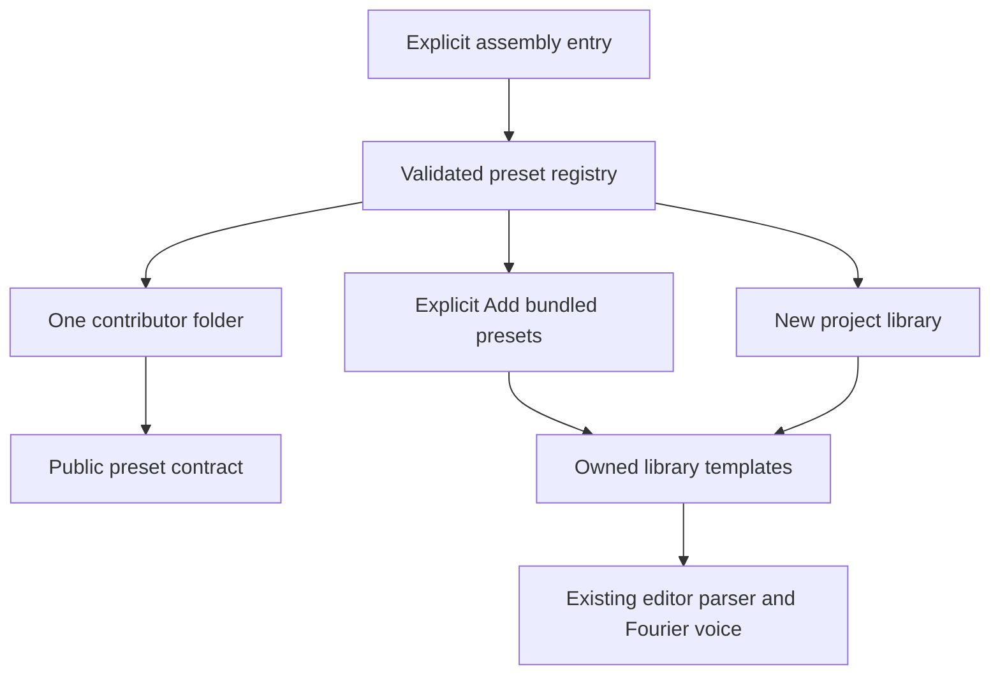
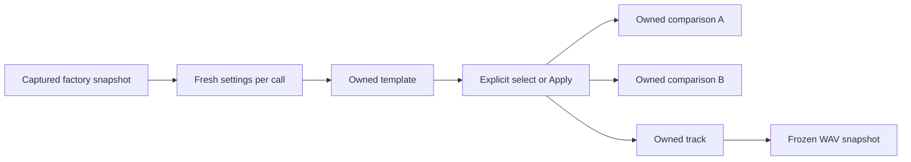
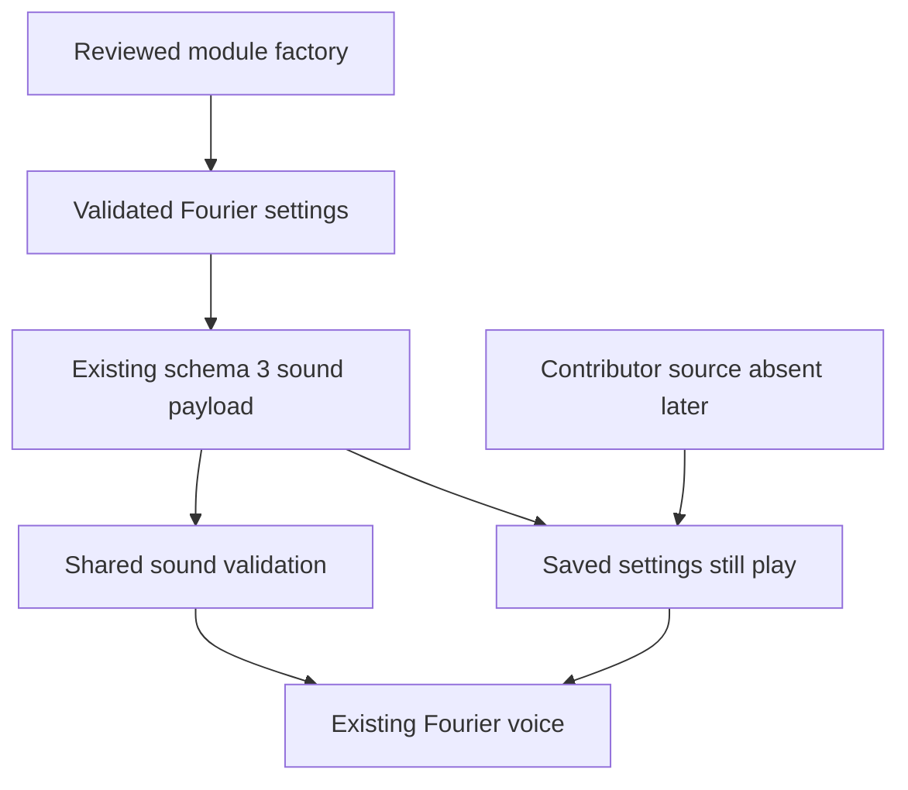

# Fourier preset modules — API 1, v0.34.0

M3 implements source-reviewed preset registration. The nine previous factory timbres and the independent **Mellow pluck** example use the same validated contract. The existing Fourier voice, source editor, parser, playback clocks, folders/history and WAV rendering remain host services. This is a preset-data API; M4's independent synthesis-engine API is still planned.

## Add a timbre

1. From a clean checkout, run `npm ci`. Copy [the Mellow pluck folder](../../src/modules/examples/mellowPluck/index.ts) under `src/modules`. Import only the [public barrel](../../src/modules/index.ts), using `defineFourierPreset`, `fourierShape` and `FourierSound`.
2. Choose a namespaced `namespace:instrument/name` module ID, distinct `libraryId`, suggested `scoreKey`, label, template version, author/attribution and tags. API/data versions are currently both 1. Contributors cannot claim `fourpataka:` IDs.
3. Return deterministic, fresh supported Fourier settings from `createSound`. Start with `fourierShape('sine' | 'square' | 'saw' | 'triangle')`, then change coefficients/envelope/trim as needed. The registry validates two factory outputs, rejects observable nondeterminism, captures an independent snapshot and returns fresh deep copies thereafter. This check is not a proof that arbitrary source has no side effects; source remains reviewed.
4. Add one import and registration entry in [assembly.ts](../../src/modules/assembly.ts)'s `instrumentModules` list. Built-ins alone go in its reserved-ID allowlist. No root component, parser or voice branch is needed for another preset.
5. Run `npm test -- tests/unit/presetModules.test.ts tests/unit/moduleBoundaries.test.ts`, `npm run build`, and `npx playwright test tests/browser/preset-modules.spec.ts`. Add numeric, ownership and workflow proofs for your timbre. [CONTRIBUTING.md](../../CONTRIBUTING.md) covers browser/native setup.

Mellow pluck has six nonzero harmonics, a negative second-harmonic sign, 8 ms attack, 160 ms release, −15 dB trim and an existing 160 ms hit-decay layer with zero noise. It illustrates editable baked data rather than a new engine or a physical instrument model. Select it in a fresh library, then use `track plucks using mellowPluck {` with notes inside on separate lines. Its folder and assembly entry supply all discovery and score-key behavior.

## Public data contract

`FourierPresetModule` contains `id`, `apiVersion`, `dataVersion`, `libraryId`, `scoreKey`, `label`, `templateVersion`, `author`, `attribution`, `tags`, optional `preview`, and `createSound`.

- Module IDs use `namespace:instrument/name`; library IDs identify project templates. Suggested score keys start with a letter and contain letters, digits or underscores. Duplicate module IDs, library IDs or suggested keys fail assembly.
- API version describes this code contract. Data version 1 describes the supported Fourier shape. Template version identifies factory revisions; it does not reapply a library sound to tracks. This API began at schema3; current project saves use schema5.
- Preview metadata optionally provides a note, positive duration in quarter beats, and hint. The host derives hit-preview defaults/hints from registered preview metadata. Tags do not create project folders or rewrite membership; folders remain user-owned.
- Metadata/tags/preview are copied and frozen. `createTemplates()` returns new template objects and fresh sounds. Neither mutable caller settings nor a later edit to a factory's original object can change registered defaults.
- Attribution identifies provenance; it grants no project license. Contributions use GPL-3.0-only with compatible upstream notices under CONTRIBUTING.md.

`FourierSound` supports 32 `harmonics` magnitudes in [0,1], 32 `polarity` signs of +1/−1, five `undertones` magnitudes in [0,1] and a separate enable flag. Coefficients are absolute; neither registration nor audio normalizes them. Preserve silent or above-Nyquist coefficients in saved data. Signs and strengths are independent.

Attack is 0.005–2 seconds, release 0.01–3 seconds, trim −36–0 dB. Optional waveform points retain the existing 3–32-point, fixed-endpoint, spacing and amplitude rules. Optional `percussion` uses noise [0,1], high/low-pass Hz [20,16000], body decay [0.01,2] seconds, optional noise decay [0.005,2] seconds and optional falling pitch [0,48] semitones with [0.005,0.5] seconds decay. These are existing voice capabilities. The public validator and host importer share one implementation; legacy schema-1 import still validates 16 coefficients before padding.

## Discovery and ownership

Fresh projects get all registered templates. Existing projects retain their library and receive new M3 presets only through **Add bundled presets**. The action adds missing suggested keys, resolves library-ID collisions with suffixes, fails atomically at 128 presets and enters one undo operation. Occupied keys, customized templates, folders, source, tracks and A/B remain unchanged. Repeating it when nothing is missing returns the same project. The older percussion-availability migration remains compatible and does not silently add Mellow pluck to an old library.

Saving an edited template does not update applied tracks. Existing exact-match Soft bass/hi-hat/drum factory migrations remain conservative; their recognized library upgrade never rewrites A/B or applied sounds. A new contributor template version affects new defaults, not existing copies. This release supplies no general module-settings migration callback or automatic factory update action.

## Saved-project compatibility

Saved presets contain complete sound settings, project template identity/key/version and existing folder metadata. They do not require a namespaced preset module reference. Consequently, removing the contribution's source does not disable saved sounds; a missing-engine envelope is a separate M4 concern. Existing schema 1/2 imports, schema 3 pedal recovery, source authority, comparison clocks and native privileges remain unchanged. There is no runtime installer, download, new notation grammar or schema bump in M3.

## Proofs and limits

Unit checks cover metadata/version/default/duplicate/reserved failures, deterministic capture and copy isolation, explicit import/collision/capacity/occupied-key behavior, conservative migrations and JSON round-trips. Browser checks render all ten factory sounds at 44.1/48 kHz, check finite headroom and exact frozen example WAV parity, exercise selection/listening/source/reload/import/undo/narrow layout, and retain existing folder/A-B-clock/WAV proofs. Native checks cover the example's baked source and sound through saving/reopening/playback, plus affected library and file/export workflows. Actual results are in [implementation status](../../IMPLEMENTATION_STATUS.md).

Do not infer physical realism, CPU suitability for every device or perceptual approval from numerical tests. M4 engine/lifecycle and M5 feature contracts are implemented; see the maintainer guide for M6 operations. Tiny-chamber acoustics and manual listening/device/screen-reader gates remain open.
