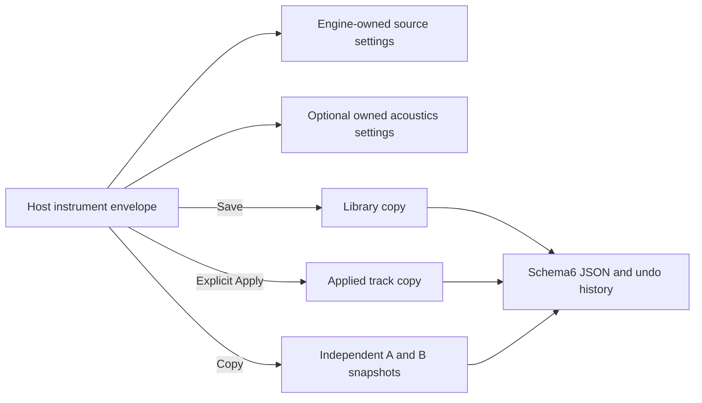
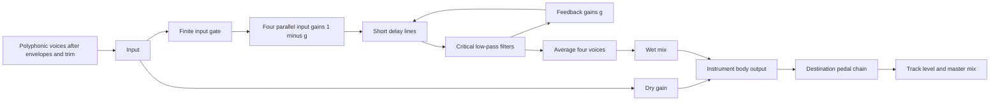
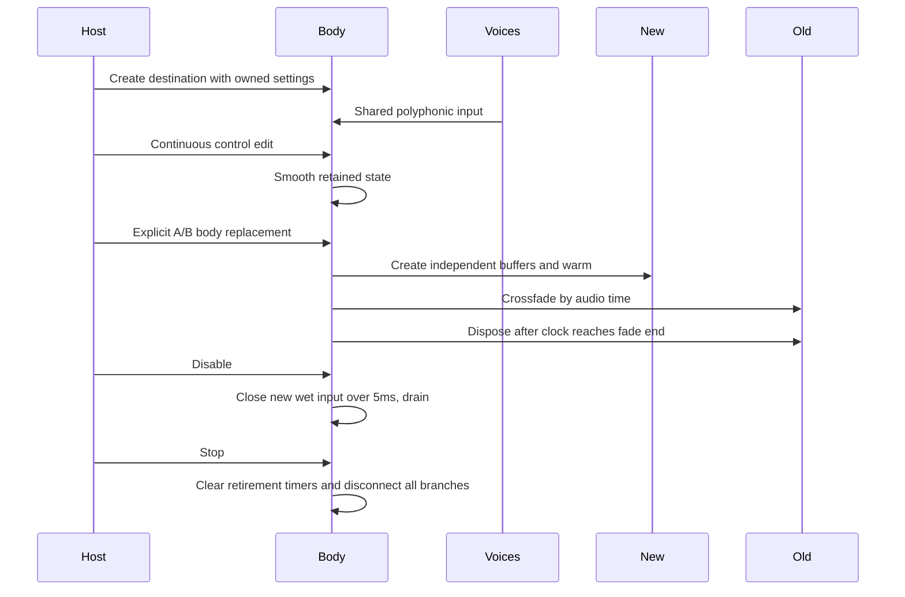

# Instrument acoustics — v0.42.0

The Instrument builder's **Acoustics → Tiny chamber** adds an algorithmic body approximation. It requires no recordings, IR assets, convolution or downloads. It is separate from the planned track/master space-reverb pedal. Use modest mix settings for coloration; this is not a physical piano, brass bore or soundboard model.

## Saved settings and module boundary

The public `InstrumentAcoustics` type and validation live in [acoustics.ts](../../src/modules/foundation/acoustics.ts), exported through [the module API](../../src/modules/index.ts). Optional `sound.acoustics` belongs to the host instrument envelope, outside a contributed engine's private settings. It works for Fourier and independent engines. Engine modules create their normal voices; the host combines those voices and applies one body. Do not duplicate the chamber inside each voice or count its state as engine voice resources.

Enable defaults off. Linear mix is0–100% (default25), size1–8ms (4), decay40–600ms (180), damping500–14000Hz (6000). Size means the shortest requested reflection delay, not metres. Decay is a conservative low-frequency −60dB target, not an exact measured RT60 for every frequency. Damping is the low-pass cutoff; lower values darken the body. Reset restores off/default settings in one undo operation. Disabling closes new input while existing body history decays; Stop clears the whole session.

Schema6 saves these settings for independent library, applied track and A/B copies. Versions1–5 import with acoustics absent/off; no existing timbre is regenerated. Older hosts reject schema6, preventing silently dry playback of a new chamber song. Partial, nonfinite and out-of-range acoustic settings fail atomically, including on unavailable engine envelopes. Ordinary library Save does not update tracks; explicit Apply copies the body along with the instrument. Engine changes, engine parameter edits, waveform reset and macros preserve the host body.

See [engine modules](ENGINE_FOUNDATION.md) for voice factories and [preset modules](FOURIER_PRESETS.md) for immutable defaults. This release provides one host chamber topology. Alternative acoustic algorithms/registries need a separately versioned contract; there is no runtime acoustic plugin loader.

## Signal and bounded network

[chamber.ts](../../src/audio/chamber.ts) implements four parallel damped combs with requested delays `sizeMs × [1, 1.31, 1.73, 2.11]`. Their first passes provide short reflections; recirculation supplies the body decay. Each feedback path includes a critically damped low-pass and gain `g`. New input is scaled by `1-g`; the four outputs are averaged with gain0.25. This avoids a hidden static resonance gain boost. Linear mix is `(1-m) × dry + m × body`. No normalization, limiter, stereo widening or random noise is added. Stereo channels keep independent histories; the same model supports mono.

The damping cutoff is clamped to0.2×sampleRate. Web Audio interprets low/high-pass Q in dB: `20 × log10(0.5)` encodes linear Q0.5. Other filter types use different Q semantics; see the [Web Audio specification](https://www.w3.org/TR/webaudio-1.0/#dom-biquadfilternode-q). Confusing those units caused an initial resonance failure, caught in offline renders before release.

For requested delay `d`, cutoff `f` and decay target `T` in seconds, `g = 0.001 ** ((d + 128/sampleRate + 2/(PI*f))/T)`. The render-quantum allowance and filter group-delay guard make the nominal decay conservative; they do not add track alignment latency. Low-pass critical poles remain real/nonnegative below the cutoff bound. Feed and feedback targets share15ms smoothing; size/filter/mix edits retain existing buffers. The rendered extrema and transition tests complement this static stability argument rather than claiming it proves all possible automation sequences.

Supported rates are3–192kHz. Each enabled destination declares25 nodes and384KiB state; an untouched dry-only body allocates6 gain nodes and no feedback/delay buffers. The wet network is created lazily on first enable. Four50ms delay capacities cover the requested maximum16.88ms spacing. Node/memory estimates enter export preflight, including every allocated destination. Reflection timing is intentional coloration: reported alignment latency is0.

## Clocks, lifetime and shared rendering

Each track has one body shared by its voices, before its pedal input. Audition uses the same factory before its selected chain. Tracks and comparison branches never share runtime buffers. Continuous editor changes retain the current body and musical clock. Explicit A/B changes warm an independently owned branch for at least25ms (extended through the reflection/filter horizon at low sample rates), crossfade20ms, then retire the old branch. Score comparison changes only the selected destination and restores the previous destination from its frozen applied sound. Rate/voice phase and future note scheduling remain host responsibilities.

Retirement checks the audio clock, so suspending the device cannot disconnect a branch ahead of its scheduled fade. Disposal is idempotent and also clears pending timers. Disable restores dry unity with a short wet overlap; it is not hard Stop. The1.3s body budget includes up to twice the maximum nominal decay plus settling/feed allowance. Feedback is mathematically asymptotic; the budget is a tested inaudible-tail threshold, not a promise of sample-exact zero after that time. Retained live cleanup budgets never shrink after longer settings were used.

[scoreGraph.ts](../../src/audio/scoreGraph.ts), [engine.ts](../../src/audio/engine.ts) and [export.ts](../../src/audio/export.ts) share this destination stage. Live score settings retain the existing frozen-until-replay policy except explicit comparison overrides. WAV freezes independent sound/body settings before asynchronous preparation, adds body tails serially before track/master effect tails, accounts for resources, and warns/fades if the effect-tail cap truncates decay. Raw waveform, harmonic/source analysis and drum thumbnails remain source views; processed output measurements include the chamber and pedals.

## Evidence and extending this work

Tests cover schema migration/validation/copies; dry unity; finite extrema at3/44.1/48/192kHz; reflection spacing, damping and decay effects; exactly silent channel isolation; disable drainage; resource/disposal counts; device-clock suspension; live clock/voice retention; A/B/track ownership; and frozen WAV parity for Fourier and independent engines before nonlinear overdrive at44.1/48kHz. At the highest rates, recursive filtering introduces small floating-point differences in proportional stereo signals; the ratio test permits30 micro-units, while a silent input channel must remain exactly silent.

Actual UI checks exercise exact/keyboard-capable controls, save/apply, undo/reset, reload, engine/source independence and responsive layouts. The native workflow additionally saves/reopens JSON and renders/saves WAV. CI includes all acoustic suites. [Implementation status](../../IMPLEMENTATION_STATUS.md) records executed checks and package hashes; test definitions alone are not passing evidence. Physical listening, device latency and wider accessibility remain separate gates. Future material/resonance presets, physical modelling and the space-reverb pedal remain planned.
