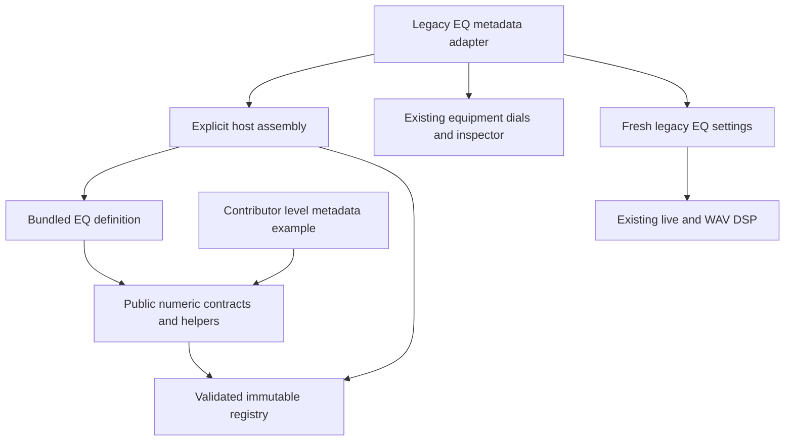
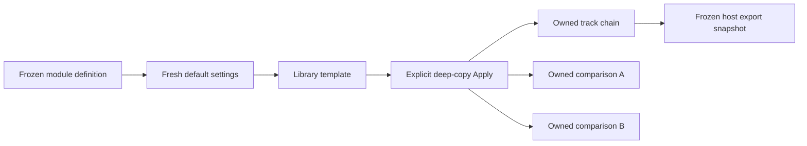
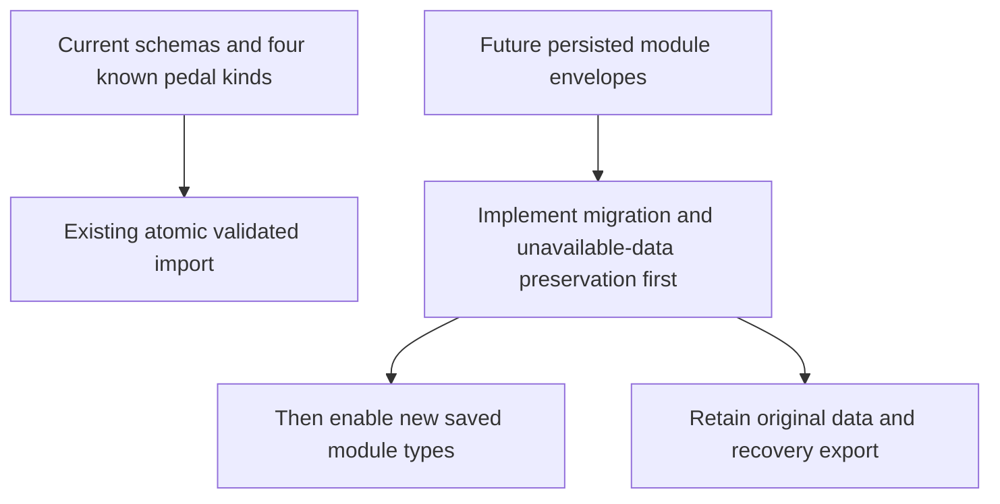

# Numeric module foundation — API 1

Implemented in v0.32.0 as M1's deliberately narrow foundation. Its compatibility matrix below records that release. v0.33.0 extends it with the [M2 playable pedal API and schema-3 recovery](PEDAL_MODULES.md); use that tutorial for current DSP/assembly/persistence work. The public entry point is [src/modules/index.ts](../../src/modules/index.ts). It supports immutable numeric metadata, validated explicit registration and fresh settings. The existing EQ consumes this boundary for its name, defaults and control ranges. Audio factories, equipment discovery and persisted pedal kinds still use their current host interfaces. M2 adds the complete pedal contract; this release does not make an arbitrary registered definition playable.

## Dependency boundary



Arrows represent imports/consumption. Public helpers import no React, core state, audio, Electron or assembly. Contributor definitions import only the public barrel. The host owns assembly and adapts registered metadata to current behavior. [The boundary check](../../tests/unit/moduleBoundaries.test.ts) rejects private imports, external dependencies and cycles in this foundation. The earlier chord registry has its own separate contract and is excluded from this check.

## Add a metadata definition

Start with [the runnable example](../../src/modules/examples/levelMetadata.ts), which imports only `../index`. Choose a stable namespaced ID and supply all numeric descriptors:

```ts
import { MODULE_API_VERSION, defineNumericModule } from '../index';

export const levelMetadata = defineNumericModule({
  id: 'example:pedal/level',
  category: 'pedal',
  label: 'Example level',
  apiVersion: MODULE_API_VERSION,
  dataVersion: 1,
  parameters: {
    gain: {
      label: 'Gain',
      description: 'Level relative to the input signal.',
      min: -24, max: 12, step: 0.5, unit: 'dB', defaultValue: 0,
      update: 'continuous',
    },
  },
});
```

Register explicitly in a test or a reviewed host assembly:

```ts
import { createModuleRegistry, defaultModuleSettings, validateModuleSettings } from '../index';
import { levelMetadata } from './levelMetadata';

const modules = createModuleRegistry([levelMetadata]);
const definition = modules.get('example:pedal/level');
const settings = defaultModuleSettings(definition);
settings.gain = -3.25;
validateModuleSettings(definition, settings, 1);
```

The example is compiled by the production TypeScript build and exercised by [registry tests](../../tests/unit/moduleRegistry.test.ts). It is intentionally absent from production assembly/equipment: no audio factory exists for it yet. Registration alone never extends the parser or project validator.

To adapt metadata today, see [EQ](../../src/modules/pedals/eq.ts), [host assembly](../../src/modules/assembly.ts) and [legacy adapter](../../src/core/pedals.ts). `LEGACY_MODULE_IDS.eq` maps the old persisted `eq` kind explicitly to `fourpataka:pedal/eq`. Existing EQ DSP shape constants remain in the host. M2 removes remaining host kind switches through a separate audio/serialization contract.

## API reference and failure behavior

- `defineNumericModule(definition)` validates and copies declared metadata, then deeply freezes it. Caller mutations cannot change assembled definitions. IDs use `namespace:category/name`; supported categories are `pedal`, `instrument`, `engine` and `feature`. These categories do not yet provide category-specific runtime APIs.
- `createModuleRegistry(definitions, options?)` revalidates definitions, rejects duplicates and reserves the `fourpataka:` namespace. Only explicit host `builtInIds` can allow reviewed built-ins. `get(id)` fails visibly when absent; it never substitutes a different module.
- `defaultModuleSettings(definition)` returns a new mutable numeric record each call.
- `validateModuleSettings(definition, settings, dataVersion?)` requires the exact current data version, all and only declared keys, finite numbers and inclusive bounds. It validates without modifying the caller. Unsupported versions fail; no automatic migration is provided.
- `moduleControlRanges(definition)` returns frozen `[min, max, step, unit]` tuples for adapters. These are UI increments: saved values such as `frequency: 731.5` remain valid even with a 10 Hz slider step.

Use definitions returned by `defineNumericModule` or the registry when calling settings/range helpers. Numeric descriptors need nonempty bounded labels/descriptions, finite ascending bounds, finite span, positive bounded step and an in-range default. Parameter keys must be safe identifiers; there are 1–64 parameters per definition. Units are `dB`, `Hz`, `ms`, `s`, `%`, `:1` and `linear`. Conversions belong at the relevant DSP boundary; recording a unit performs no conversion. `update` is `continuous` or `replay`, describing intended behavior rather than implementing smoothing or scheduling.

## Ownership and identity



This diagram shows existing ownership policy, not a new Apply API. The host still copies complete chain/project structures, owns history and export snapshots, and preserves clocks/phase/latency. Changing metadata or a template never reapplies mutable settings to those owned copies.

Keep these identities separate: namespaced module ID; API version (code contract); data version (numeric settings payload); project schema (outer file); library ID/key/template version; and pedal instance ID. Names and score keys are user data and must not be derived from a module display label. API 1 here means numeric metadata API 1, not the earlier chord API or a promise of a pedal DSP API.

## Compatibility matrix

| Input/boundary | Current M1 behavior | Proof / later gate |
| --- | --- | --- |
| Legacy schema 1 | Imports as schema 2; preserves original 16 signed coefficients, appends 16 silent partials, preserves source and owned chains | [Fixed legacy fixture](../../tests/fixtures/m1/schema1-owned-eq.json), unit and native round-trip |
| Existing schema 2 / `eq` kind | Current serialization and import rules remain; fractional EQ settings survive | [Compatibility tests](../../tests/unit/moduleCompatibility.test.ts), EQ/browser/WAV/native checks |
| API 1 numeric definition | Validated, copied, frozen; reserved and duplicate IDs fail | Registry and import-boundary tests |
| Numeric settings data version | Exact registered version and declared keys; no clamping or slider-step quantization | Registry tests |
| Example metadata registration | Compiles and yields defaults; does not create a playable pedal | Public example and production build |
| Unknown persisted pedal kind / future schema | Existing importer rejects it; registry registration does not change this | Compatibility rejection test |
| Missing/incompatible saved module | Preservation envelope, migrations, disabled placeholders and recovery/export remain planned | Required before M2 enables new saved types |



The future preservation policy is defined in [compatibility](COMPATIBILITY.md). It must retain unknown data/requirements, expose unavailable nodes clearly and avoid silently changing the sound. M1 supplies no such envelope and needs no schema bump.

## Reproduce and extend

From a clean checkout: `npm ci`, then `npm test -- tests/unit/moduleRegistry.test.ts tests/unit/moduleCompatibility.test.ts tests/unit/moduleBoundaries.test.ts` and `npm run build`. [CONTRIBUTING.md](../../CONTRIBUTING.md) covers the browser/native setup. A definition should have malformed/default/version/duplicate tests and proof that independent settings remain independent. A DSP contribution must additionally satisfy the planned [M2 pedal](PEDALS.md) live/offline, latency, tail, Stop and persisted-data gates.

M1 is bundled reviewed source, not an installed-package SDK or runtime loader. The owner has not selected a project license; M6 licensing/attribution/publication readiness remains open. Existing physical listening/device/screen-reader release checks also remain manual gates. Current verification is recorded separately in [implementation status](../../IMPLEMENTATION_STATUS.md).

## Optional discrete settings (hostv0.40.0+)

Numeric descriptors may declare `choices`, a frozen sorted list of2–32 finite exact numeric alternatives inside min/max including the default. Saved settings must match an alternative; ordinary step values still do not quantize imports. Pedal controls snap interactive values to the nearest choice and offer an exact select. Existing API1 definitions need no change. See the [phaser walkthrough](PHASER.md) for the4/6/8-stage example and minimum-host compatibility.
