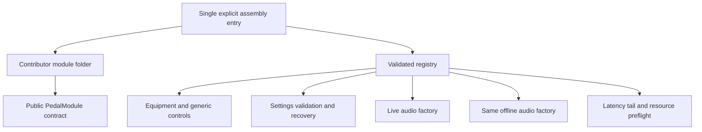
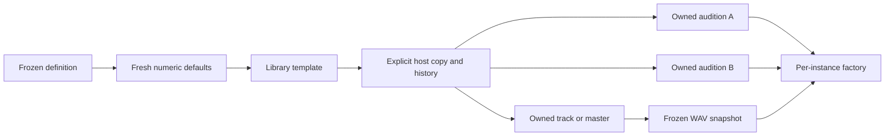
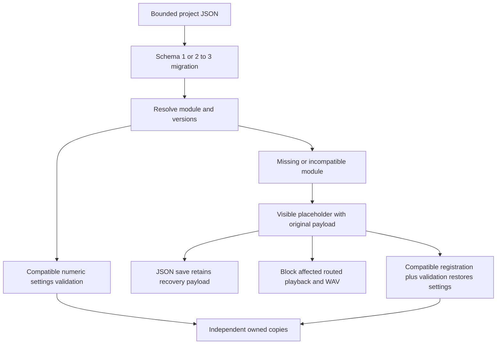

# Playable pedal modules — API 1, v0.33.0

See [Chorus](CHORUS.md) for opposed delays, causal controls, finite bypass drainage and live/WAV ownership diagrams.

M2 implements reviewed, bundled TypeScript pedal contributions. Compressor, Overdrive, EQ, Delay, Phaser and the independent **Level** tutorial pedal use the same contract. Equipment, placement acceptance, parameter names/ranges/defaults, reset/help, validation, audio dispatch, latency, resource estimates and WAV musical tails consume the registry. Cable order, score authority, owned copies/history, scheduling, Stop and native privileges remain host responsibilities.

## Add a pedal from a clean checkout

1. Run `npm ci`. Read the [numeric foundation](MODULE_FOUNDATION.md), then copy [the Level module folder](../../src/modules/examples/level/index.ts) to your own folder under `src/modules`. Its only import is the public `src/modules/index.ts` barrel.
2. Choose your own namespaced `namespace:pedal/name` ID. Set `apiVersion: MODULE_API_VERSION`, `dataVersion: 1`, author/attribution and numeric descriptors with explicit units. Contributors cannot claim a legacy kind or the reserved `fourpataka:` namespace.
3. Implement `create(context, settings, bypassed, environment)` plus latency, runtime-tail, export-tail and resource declarations. Use the same factory for live and offline contexts. Keep every instance's nodes, buffers and state independent.
4. Import your definition and add it to `definitions` in [assembly.ts](../../src/modules/assembly.ts). Only built-ins go in `builtIns`. That is the single host registration edit; no new parser, menu, validator, DSP-switch or WAV-estimator branch is needed.
5. Run `npm test -- tests/unit/pedalModules.test.ts tests/unit/moduleBoundaries.test.ts`, `npm run build`, and `npx playwright test tests/browser/pedal-modules.spec.ts`. Add your own transfer-function, extrema, update, sample-rate, latency, tail and cleanup proofs. [CONTRIBUTING.md](../../CONTRIBUTING.md) covers Chrome/native verification.

The Level folder is intentionally registered in the normal build, so it is usable from **Pedalboard → Equipment → Level**. It has output gain and linear mix dials, exact inspector controls and reset. The older `levelMetadata.ts` remains the M1 data-only tutorial; it is not a second playable registration.

## Contract reference

`definePedalModule` extends the numeric API with these fields; `createPedalRegistry` validates assembly and rejects duplicate IDs/legacy aliases. Definitions/descriptors are copied and frozen; runtime functions are reviewed source, never loaded from JSON. Contributor imports may target the public barrel; the dependency check rejects host/private imports and cycles.

- `id`, `category: 'pedal'`, `label`, `apiVersion`, `dataVersion`, `parameters`: the numeric foundation. Descriptor labels drive accessible control names. Bounds validate saved values; step is a UI increment, not import quantization. `update` declares continuous/replay intent; it does not implement a clock or smoothing.
- `author`, `attribution`: identify source provenance. Attribution is not a license grant. Contributions use GPL-3.0-only with compatible upstream notices; see CONTRIBUTING.md. Attribution alone does not grant reuse rights.
- `bypass: 'dry' | 'drain'`: the documented policy. A factory must implement it; the host passes pedal/whole-chain bypass. Delay gates new input while stored wet echoes drain. Other bundled pedals use aligned dry unity.
- `note`, optional `reset: { label, accessibleLabel }`: generic inspector help/reset. Use `{index}` in accessible reset labels. Reset replaces settings with fresh descriptor defaults in one host history operation, preserving instance identity/order/bypass.
- `nodes`, `memoryBytes`, `minimumSampleRate`, `maximumSampleRate`: declared resource/support estimates. Counts and bytes are bounded; supported rates lie within 3–192 kHz. Node count is a coarse workload indicator, not a measured CPU guarantee. Delay declares conservative stereo buffer storage at its maximum supported rate. Native Web Audio internals may allocate additional memory; this is preflight, not a sandbox or exact allocator measurement.
- `latency(environment)`: finite nonnegative **seconds** of processing/look-ahead delay. `environment` supplies the actual sample rate and host-measured compressor/oversampling delay. Returned runtime latency must match this declaration. Musical delay and EQ phase are not scheduling latency.
- `tail(settings, environment)`: conservative finite runtime tail in seconds, including filter settling where relevant. `exportTail(settings)` declares additional musical tail; the host already budgets release, latency and a 100 ms filter-settling allowance. Delay adds its finite repeat bound; Level adds zero.
- `create(...)`: returns `input`, `output`, `latency`, `tail`, `tailActive`, `update(settings, bypassed)` and idempotent `dispose()`. Use getters for changing tail state. Hard Stop disposes the instance; nodes, callbacks and future work must not survive it.

Factories may build their own graph. The optional public `createMixedProcessor` helper owns nodes registered with `own(...)`, initializes parameters directly, then smooths subsequent values over 15 ms on the audio clock. It expects numeric `output` in dB and `mix` in percent. Its linear mix is `dry * (1 - mix/100) + processed * gain(output) * mix/100`; bypass uses dry unity unless the setup declares `drain`. Setup/initial-update failures clean registered nodes, and disposal is idempotent. `dbGain`, `delayTailSeconds` and `checkedSeconds` are shared public helpers.

For Level, gain −6 dB gives `10 ** (-6 / 20) ≈ 0.5012` at full wet mix, approximately 0.7506 at 50%, and unity at zero mix/bypass. Its latency/tail are zero. This makes the example's behavior independently measurable.

## Host ownership and audio flow

Registering or editing a template does not reapply it to owned tracks/A-B. The host freezes score parameters while playback continues, permits live bypass against matching instance IDs, and uses the existing continuous A/B clock. Modules must not replace source text, transport clocks or another instance's settings. Visual placement is independent of cable order; only the routed path gets processors. Unsupported routed modules/rates are rejected before allocating a partial score graph.

Export preflight sums declared chain resources and rejects estimates over 4096 nodes or 128 MiB. The existing PCM/voice budgets, clipping review, tail-cap warning/fade and monitor-level exclusion remain. These resource limits do not authorize untrusted code or runtime installation.

## Saved data and compatibility

The M2 pedal envelope was introduced in **schema 3**. Current saves use **schema 5**, importing schemas 1–4; schema 1 still pads its original 16 signed harmonics to 32. Existing built-ins retain `compressor`, `overdrive`, `eq`, `delay` persisted kinds and their previous settings. No automatic reapplication occurs. Older releases reject schema 3; retain a backup before using a newer project in an older app. There is no downgrade writer.

Contributed instances use the module ID as `kind` plus `module: { id, apiVersion, dataVersion }`. Instance ID, library ID/key/template version and score key remain separate identities. Built-in legacy data is implicitly API/data 1; changing that assumption requires a future migration/envelope update. Only exact current API/data versions execute. Version migration callbacks are not implemented in this release.

Unavailable instances store empty executable `params` plus `unavailable: { reason, original }`. `original` preserves the complete bounded raw instance, including opaque future settings/extra fields. JSON round-trips retain this payload; the inspector shows ID/reason and a remove action. Removal is an explicit host history operation. The importer recomputes availability/reason and restores original settings if a compatible registration later exists. Host bypass changes are preserved independently of the raw payload. No arbitrary placeholder parameters reach DSP.

Opaque recovery data is limited to eight nested levels, 64 entries per object/array, finite numbers and bounded strings/keys. Unsafe prototype keys, malformed identities/references and invalid known settings fail atomically; missing code is distinct from malformed data. A missing unused library item or off-path pedal does not disable unrelated supported destinations. An unavailable pedal on a routed path blocks that destination even when bypassed: its required latency/behavior is unknown. Raw JSON saving/recovery and Stop remain available. See [compatibility](COMPATIBILITY.md) for the wider policy.

## Verification and troubleshooting

The shared browser harness checks all six registered processors at 44.1/48 kHz for finite output, bypass/dry agreement and repeated disposal. Effect-specific regression checks retain measured compressor/oversampling alignment, EQ spectra, delay cadence/feedback/tails, Stop, A/B continuity, routed order and frozen WAV ownership. Level additionally has analytic gain/mix, mouse placement/cables, keyboard dial/reset/history, copy/reload/narrow and native JSON proofs. Unit fixtures cover schema migration, malformed/unknown/newer versions, opaque recovery, re-enabled registration, independent copies and failed-factory cleanup. Actual release results are in [implementation status](../../IMPLEMENTATION_STATUS.md).

If equipment is absent, confirm its assembly entry and unique ID. If import creates a placeholder, inspect the ID/API/data versions; never relabel another module to consume incompatible settings. If gain/timing differs between live and WAV, check unit conversion, measured latency and whether both paths call the same factory. If Stop leaks audio, check every owned node/timer and idempotent disposal. Source registration does not install a package, add notation grammar or grant native file permissions.

M1–M5 are implemented. See the [maintainer guide](../MAINTAINING.md) for M6 contributor/release operations. Phaser/chorus/reverb and runtime loading remain separate future work.

## Modulated processors (hostv0.40.0+)

[Phaser](PHASER.md) illustrates optional context-second `environment.timeOrigin`, exact numeric stage choices, warm stage selection, measured feedback-cycle timing and a parameter/sample-rate tail budget. Host live sessions pass their start; WAV uses0. A factory must preserve phase on ordinary updates and declare initialization/replacement limitations. Register scheduled sources with `own(...)`: shared mixed-processor cleanup now calls their stop method as well as disconnect, including failure paths. Dispose remains idempotent. Phaser has no legacy kind; reserved built-in IDs do not imply a legacy alias. Phaser/Level plus the four original effects share discovery and routing. Chorus/reverb remain planned.
