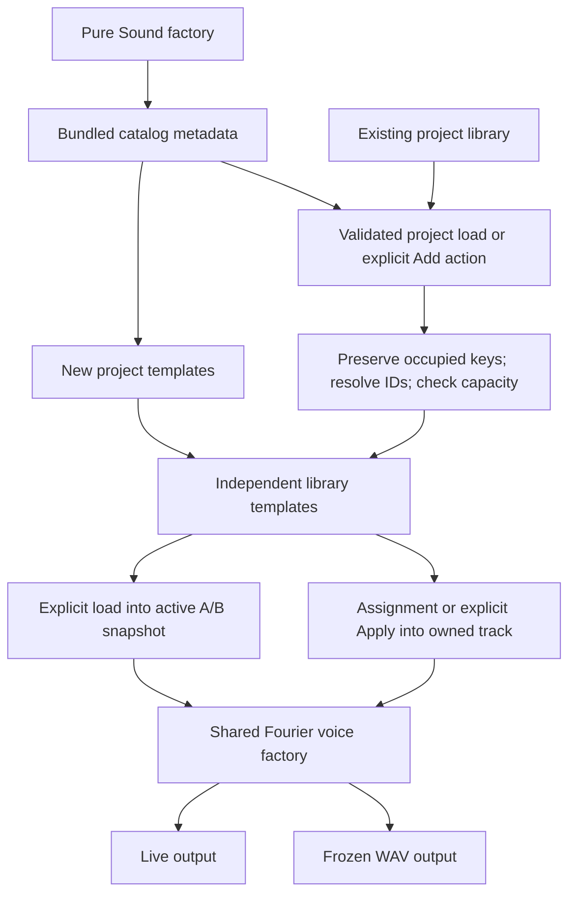
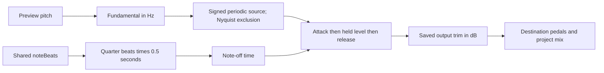
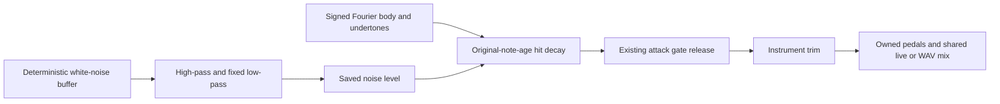
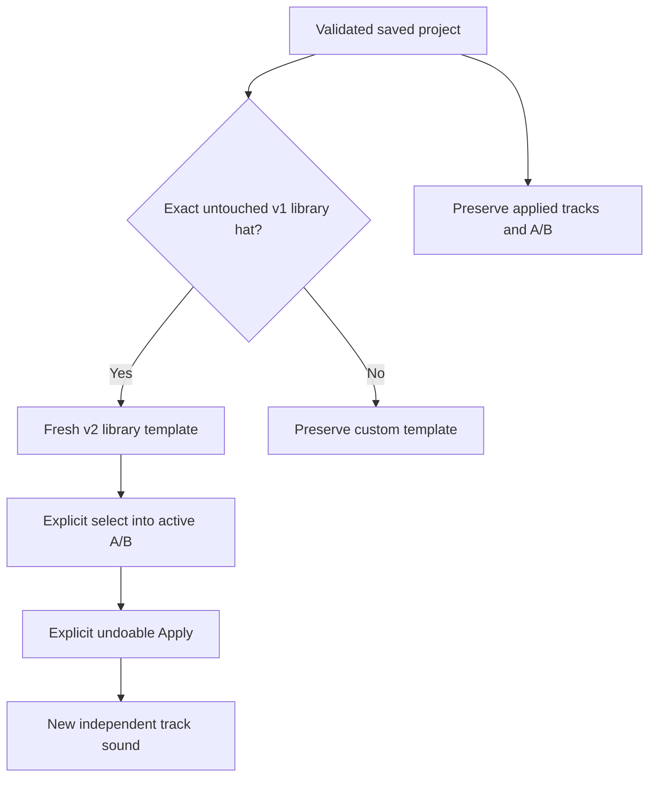
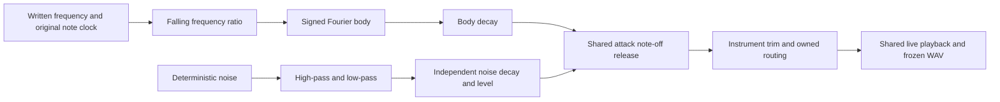
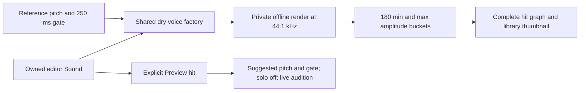

# Percussion presets and noise hits

The v0.25.0 source includes three editable percussion-inspired timbres: **Kick** (`kick`), **Closed hi-hat** (`hiHat`), and **Snare** (`snare`). v0.31.0 corrects the bass-heavy Snare v2 with a noise-led v3 and complete-hit rendering. v0.30.0 replaced the Kick and Snare factories with decaying drum bodies, falling pitch and filtered-noise transients. v0.29.0 replaces the factory Closed hi-hat with quiet metallic partials plus a filtered noise burst and automatic hit decay. This is a bundled preset contribution, not completion of the planned M3 module API or M4 synthesis engines.

## Use them

New projects include the three presets. Since v0.25.1, loading an existing local session, importing JSON or restoring recovery also adds missing bundled percussion before parsing. No separate setup action is required: they appear in Instrument and their score keys are available to the IDE. Occupied keys/custom presets, owned A/B/track sounds and source text remain intact; colliding IDs receive a suffix. If all missing templates cannot fit within 128 slots, the valid project still opens unchanged. **Add percussion presets** remains a strict manual fallback and reports the capacity limit instead of partially adding a set. The original v0.25.0 required this separate action, which left existing sessions without the feature until it ran.

Select a preset and choose **Preview hit** to set its suggested pitch/gate, disable partial solo and play the current editor sound in one action. **Use hit preview**, then **Listen**, remains available for setting up repeated comparisons. The preview changes the shared comparison material's pitch and gate length, leaving the score and owned track sounds intact. The gate length selector in Comparison works for any note/chord audition; A and B use the same duration. Selecting another preset or switching A/B does not automatically change the material or restart its clock. Explicitly changing material/replaying starts a new audition.

- **Kick v2:** C2 preview, 250 ms gate, 5 ms attack, 240 ms release, −12 dB trim. A low Fourier body decays with a 120 ms e-fold time. A24-semitone initial rise falls toward the written pitch with 25 ms frequency decay; noise level 0.12 above 3000 Hz decays in 12 ms for the beater. Try C1–C2.
- **Closed hi-hat v2:** C4 preview, 31.25 ms gate, 5 ms attack, 35 ms release, −12 dB trim. Filtered white noise (level 0.85, high-pass 6500 Hz, low-pass 14000 Hz) supplies the sizzle; six H13/H17/H19/H23/H29/H31 partials at 8% of the old magnitudes supply a quiet metallic edge. A45 ms e-fold decay shortens the hit even with a long written note.
- **Snare v3 (v0.31.0):** G3 preview, 250 ms gate, 5 ms attack, 180 ms release, −9 dB trim. The supporting Fourier body has coefficients [0.18, 0.1, 0.07, 0.025] and 22 ms decay, with no pitch drop. Noise level 1 through 700 Hz high-pass / 7800 Hz low-pass decays independently over 85 ms. This emphasizes the crack/rattle instead of a bass-like pitched body. Try D3–G3; noise color stays independent of the written pitch.

## Match Snare Listen in Compose

Use **Use hit preview** (or **Preview hit**) to establish Snare's suggested G3 pitch and 0.5 quarter-beat gate at the fixed120 BPM audition tempo. Ordinary **Listen** retains the current Comparison/Audition material; merely selecting Snare does not change it. Default note material is C4 with3.2 beats (1.6 seconds), so Listen is not always the suggested hit preview.

For a fresh, unarticulated 250 ms score hit:

```text
tempo 120
master through clean
track snareTest using snare through clean {
  G3 eighth
}
```

Set the Compose track level to100% to match audition's unity track gain (new score tracks default75%). Use empty Clean chains or match the audition chain; Compose additionally includes its master chain. Both paths share project mix and monitor controls. At another tempo, match the same duration in seconds rather than assuming an eighth is always250 ms. Avoid staccato if matching the full gate; it shortens note-off.

Compose plays an independently owned sound copy. An existing track using snare does not automatically refresh after a factory/library/editor change. Save an edited Snare template and explicitly Apply the current sound to the intended track, or use a fresh track key for comparison. Disable partial solo for a full Listen comparison. The IDE chooses note/time/library key/chain; it does not currently set track level or the drum's noise/body/envelope parameters. Those belong to the saved instrument/track controls. No separate Compose snare synthesis algorithm is used.

The original v1 Kick and Snare were sustained periodic approximations. Current Kick v2 and Snare v3 factories decay during held notes. Note-off/release and articulation still bound the voice, so extremely short or staccato notes can choke a drum; use the 250 ms hit preview to hear its full shape. Hi-hat v2 is unchanged. All these timbres are editable synthesized drums; inharmonic membrane/cymbal models and broader engine contracts remain planned.

```text
tempo 120
time 4/4
track kickTrack using kick {
  staccato[
    C2 16th
    rest 8th
    C2 16th
  ]
}
track snareTrack using snare {
  rest 8th
  staccato[
    D3 16th
  ]
  rest 16th
}
track hatTrack using hiHat {
  repeat 4 {
    staccato[
      C4 16th
    ]
  }
}
```

This example is a separate test fixture; the owner's bundled demo is preserved.

## Extend the working source

See [instrumentPresets.ts](../../src/core/instrumentPresets.ts) for the pure factories and `PERCUSSION_PRESETS` metadata. Each call starts from a fresh mathematical preset and returns fresh magnitude/sign/undertone arrays. Never mutate an exported singleton `Sound`. A catalog entry has a unique ID/key, label, template version, factory, suggested pitch, quarter-beat gate and concise hint. This narrow bundled catalog is not a public runtime registry.

`createPercussionPresets()` creates owned templates. [project.ts](../../src/core/project.ts) uses it for new projects and the strict `withPercussionPresets()` action. Validated project import calls that action when the missing set fits, before ordinary parser/reconciliation; local startup, JSON import and recovery share this path. Import never rejects an otherwise valid project for lacking factory capacity. Autosave canonicalization preserves the previous distinct recovery checkpoint rather than replacing it for a bundled-only addition. A/B snapshots and tracks deep-copy the selected library sound, and saving a newer library version still requires explicit Apply to change a track. Score `using` keys come from that project's library; the parser has no percussion-specific branch.



The comparison gate is optional `comparisonMaterial.noteBeats` in schema 2, bounded to 1/64–32 **quarter-note beats**. Omitted means the original 3.2 beats. Note/chord preview tempo remains 120 BPM, so seconds = beats × 0.5. Phrase comparison ignores this field and uses the score's timing. The UI displays milliseconds; factory metadata keeps the underlying beat unit. That preview gate behavior is unchanged. v0.29.0 separately adds optional `Sound.percussion` hit data as described below; ordinary sounds without it keep the original envelope.



## Noise-hit source contract (v0.29.0)

`Sound.percussion` is optional data inside the existing schema2 sound. Omitting it preserves sustained Fourier behavior. When present, all three fields are required and validated before import:

- `noise`: linear white-noise level, 0–1. Zero retains decay on the Fourier body without audible noise.
- `highpass`: high-pass cutoff in Hz, 20–16000. Runtime clamps it below Nyquist at the context's sample rate. The low-pass defaults to 14000 Hz; optional `lowpass` (20–16000 Hz) overrides that ceiling. Both filters clamp below Nyquist and use Q 0.707. A low-pass below the high-pass is valid and attenuates the noise; it does not reverse the filter order.
- `decay`: exponential e-fold time in seconds, 0.01–2. The builder displays milliseconds. At 45 ms, hit gain reaches about 37% after 45 ms and about 1.2% after 200 ms, before the ordinary attack/gate/release envelope.

The instrument builder's **Percussive hit** toggle exposes these three controls for any sound. Disabling removes optional hit data; undo restores it. Noise is not represented by editable Fourier dots, harmonics or the steady source graph. Those graphs explicitly identify the Fourier component; playback/output monitoring includes both paths. Harmonic solo excludes noise. Saving a library template does not change applied tracks; use Apply or Apply to all using this preset.



Implementation lives in [percussionSource.ts](../../src/audio/percussionSource.ts), created once per [voice.ts](../../src/audio/voice.ts) voice. It adds no score-key special case or transport. A deterministic xorshift buffer contains one second of bounded uniform white noise per context, cached weakly; each voice owns its source/filter/gain nodes. Live and offline rendering use the same factory and seed. Repeated renders at the same sample rate are reproducible. No repository text, audio asset or network request is involved.

The noise cursor starts at the original note age if enabled later. Filter/level changes smooth over about 20 ms; hit gain changes join the decay appropriate to that original age, also over 20 ms. They do not restart the note attack or host clock. The existing Fourier phase rotation is unchanged. Ordinary envelope note-off/release still determines the finite voice end, and articulation's release limit still applies. Noise stops with the voice, including stealing, hard Stop and disposal; a noise-only voice also disconnects on completion. Noise adds no alignment latency or effect tail beyond the existing envelope. This is a synthesis layer, separate from the planned chamber and reverb pedal.

To contribute another hit today, return fresh data from a reviewed preset factory and add its catalog metadata. For example, this independent source factory needs no parser changes:

```ts
import { mathematicalPreset, type Sound } from '../../core/music';

export function brushedHit(): Sound {
  const base = mathematicalPreset('sine');
  return {
    ...base,
    harmonics: base.harmonics.map(() => 0),
    percussion: { noise: 0.55, highpass: 1800, decay: 0.12 },
    attack: 0.005,
    release: 0.04,
    trim: -18,
  };
}
```

This import is real when contributing under `src/modules/my-hit/`; catalog registration remains an explicit source change. M3/M4 public registries, unknown-engine preservation and contributor engine CI remain planned. Schema2 stays additive; old builds may ignore hit data, so they cannot reproduce the new timbre. Do not promise audio equivalence when rolling back.

On load, only the recognizable untouched `hi-hat`/`hiHat`/`Closed hi-hat` v1 factory upgrades to v2. Detection compares every legacy sound field and rejects extra/custom fields. Labels, IDs, versions or edited values prevent replacement. Existing applied v1 sounds and A/B remain owned snapshots. Select **Closed hi-hat** to load the new library sound and explicitly **Apply** to update a saved hat track. New assignments use v2 immediately. The owner's demo source remains unchanged.



Regression checks cover deterministic renders, low cycle correlation versus the old pitched hat, early/late RMS decay, noise-only output and silent solo, short-note tails, mid-note enabling/editing, Stop, validated import bounds, conservative migration, saved controls/undo and explicit copy application. Numeric tests establish behavior; perceptual realism remains a listening check.

## Verification recipe

Run `npm test -- tests/unit/instrumentPresets.test.ts tests/unit/comparison.test.ts`, then `npx playwright test tests/browser/percussion.spec.ts`. The native workflow is `npx playwright test --config playwright.desktop.config.ts --grep "packaged percussion"` against a freshly built/package-verified application.

Tests validate schema bounds, fresh banks, distinct spectral roles, and automatic availability for old sessions, parser/IDE key discovery and conservative additions (including collision/capacity behavior). The sum of magnitudes times trim bounds the Fourier component only. Noise hits also need rendered headroom checks: bundled short-hit output is finite, nonzero and below 0.65 peak at 44.1/48 kHz. This is factory evidence, not automatic normalization or a guarantee about arbitrary edited/polyphonic mixes. Offline voices verify finite nonzero output and silent tails at 44.1/48 kHz. Browser/native flows cover previews, source assignment, persistence and JSON; WAV verifies the frozen owned sounds and upper bank through the shared factory. Audible realism and physical-device response remain listening checks.

For broader module contracts and ownership diagrams, continue with [the instrument guide](INSTRUMENTS.md), [module creation](MODULE_CREATION.md), and [compatibility](COMPATIBILITY.md).


## Independent drum decay and falling pitch (v0.30.0)

Two optional fields extend `Sound.percussion` without changing old sounds:

- `noiseDecay`: separate noise e-fold seconds, 0.005–2. Omission inherits body `decay`, preserving the v0.29.0 hi-hat. Noise decay and body decay share the same note-off/release envelope and explicit trim.
- `pitch`: `{ amount, decay }`, with initial upward `amount` in semitones (0–48) and frequency e-fold `decay` in seconds (0.005–0.5). Omission preserves the written pitch. The builder shows Pitch drop in semitones and both decay controls in milliseconds. Zero Pitch drop removes pitch data.

At note age t, frequency is `f0 * (1 + (2 ** (amount / 12) - 1) * exp(-t / decay))`. This exponential is in frequency, not in semitones. Every harmonic/undertone follows the same voice-local ratio. New voices conservatively exclude partials above Nyquist at their sweep peak, preserving saved coefficients. Steady graphs describe the Fourier component at the written pitch; output monitoring includes the actual sweep/noise/decays.



[pitchEnvelope.ts](../../src/audio/pitchEnvelope.ts) owns a bounded piecewise trajectory: a 20 ms transition joins the current frequency and accumulated phase, then decays from the original note age. Its phase integral follows per-frame oscillator frequency accumulation, using a geometric sum for exponentials and sampled linear integration for transitions. [voice.ts](../../src/audio/voice.ts) rotates replacement PeriodicWave coefficients by that integral and schedules the same curve on active/retiring sources. No second transport or envelope attack is introduced. Frequency and phase join continuously when pitch settings change, including an unfinished previous transition.

[percussionSource.ts](../../src/audio/percussionSource.ts) now owns separate body/noise gain envelopes. Unchanged settings do not reschedule a decay. Changed settings analytically anchor the current gain before smoothing to the original-note-age target, preventing ramps from interpolating from the attack. Runtime sources/filter/envelope state remain voice-owned, sample-rate-aware, deterministic and fully disposable. Stop/stealing, release limits, routing latency and frozen export snapshots retain the existing policies.

Factories v2 replace only exact untouched v1 Kick/Snare library templates. Edited templates, applied tracks and A/B remain independent copies. Select Kick/Snare and explicitly Apply to refresh an existing track. New assignments use v2 immediately; the owner's demo source is unchanged. Numerical checks measure a falling pitch, phase agreement during waveform edits, noise/body separation, different decay ratios, finite bounded headroom and silent tails at 44.1/48 kHz, plus units/import/copy/control/native persistence. Manual perceptual realism and device gates remain separate.


## Noise-led snare and complete-hit preview (v0.31.0)

Snare v2 retained too much low body and its thumbnail hid the rattle. v3 reduces the body, removes its falling pitch and uses stronger noise with an editable low-pass ceiling. The same filter runs in live notes and frozen WAV voices. Cutoff updates smooth on the existing filter without replacing the noise cursor, adding latency or resetting the note clock. Omitted low-pass retains old behavior.

Only exact untouched v1/v2 Snare library factories upgrade to v3. Local startup reports a library refresh and explains that old owned playback copies remain until explicit loading/application. Kick remains v2 and the hi-hat is unchanged. Edited templates, track copies and A/B snapshots are preserved; selecting the library Snare loads the new sound, and explicit Apply updates an existing track. Preview hit auditions the current editor sound, including edits; it does not silently reload a factory or apply it to a track. Selecting presets alone and ordinary A/B switches keep their previous material/clock policy.

[hitPreview.ts](../../src/audio/hitPreview.ts) renders the shared dry voice in an OfflineAudioContext at 44.1 kHz with a fixed 250 ms gate plus saved release and 10 ms silence. [HitPreview.tsx](../../src/components/HitPreview.tsx) uses 180 min/max buckets so short transients survive display reduction. The complete-hit graph includes noise, body, pitch, envelope and trim at the selected nominal fundamental; library thumbnails use each bundled hit's suggested pitch (G3 fallback for custom hits). It is a single-note reference, independent of phrase articulation, pedals, mix gain and device sample rate. The large graph uses a fixed ±1 amplitude scale. Compact library icons scale only their drawing to reveal the transient; audio gain is never normalized. Fourier graphs/dots remain the separately editable periodic body.



Display renders debounce edits by 120 ms, discard stale results and reuse a bounded 24-entry private promise cache. They never drive the transport or touch project data. No audio asset or network request is required. Regression proofs compare preview buckets to the actual voice, measure rattle/body balance at C2/G3 and both 44.1/48 kHz, exercise cutoff color and test native JSON ownership. These measurements verify the intended sound structure; they do not establish perceptual acoustic realism. Inharmonic drum engines, chamber acoustics and broader module contracts remain planned.
