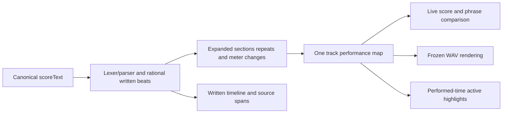
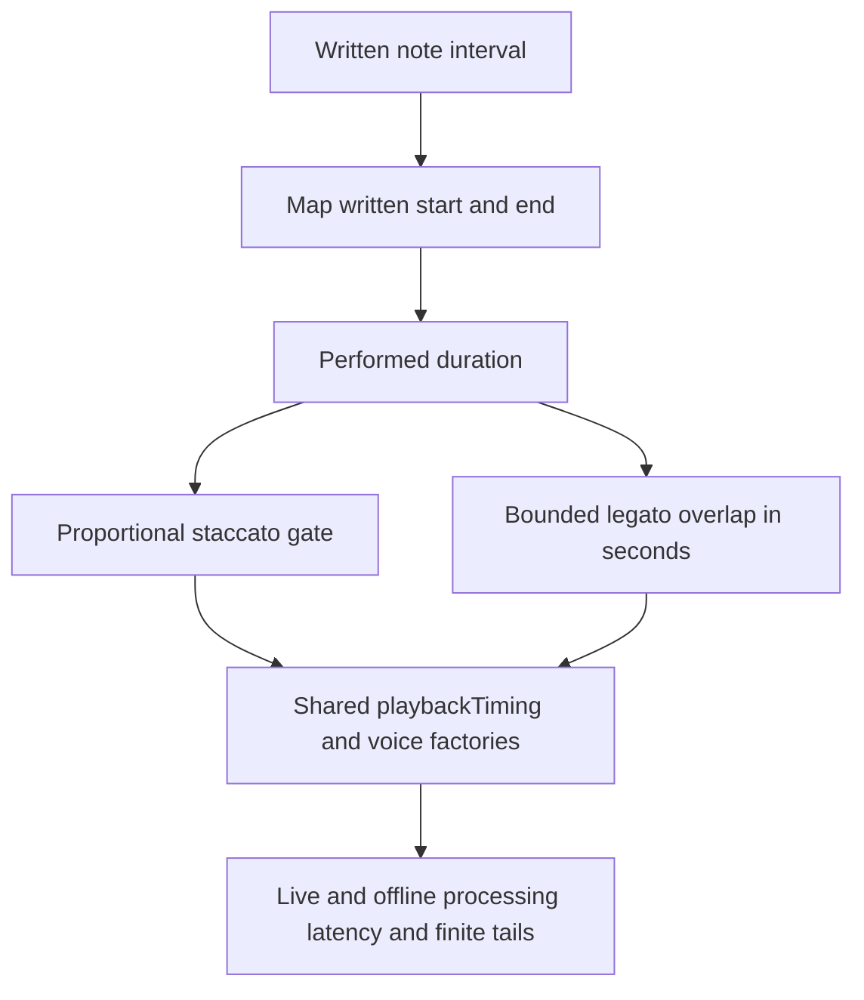
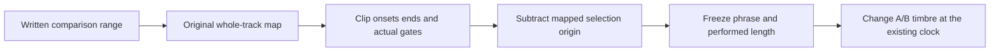

# Performance timing and variable swing

Implemented in v0.38.0. Swing is a host score-timing feature shared by Fourier, percussion and contributed engines; engines/pedals do not warp time themselves. The authored demo is unchanged. This is bundled-source grammar, not a runtime parser plugin.

## Write a groove

```text
tempo 120
time 4/4
swing eighth 66.7
track melody using sine {
  legato[
    C4 eighth
    D4 eighth
  ]
  triplet[
    E4 eighth
    F4 eighth
    G4 eighth
  ]
}
track bass using softBass {
  swing off
  C3 quarter
  G3 quarter
}
```

`swing eighth <amount>` or `swing 16th <amount>` selects eighth/sixteenth pairs; amount50–75 is the first subdivision's share of a pair in percent. Optional `%` is accepted.50 is exactly straight;66.7 approximates2:1;75 is3:1. `swing off` disables it. No command means existing straight playback with no derived timing fields.

One project-wide directive lives outside tracks and applies to the whole song. A track can override it once, before its first event (including rests); `off` overrides a swung project. Matching track parts in different virtual files share that override and absolute clock. The reference's track-swing card edits/inserts the first part's directive even when another part is selected. Duplicate/malformed/late directives and directives inside sections, repeats or bracket groups diagnose. Mid-track swing changes are not implemented. Section definitions do not play; their expanded calls receive swing once at their actual destination beats.

Autocomplete inserts blank fields, with eighth/16th/off choices after `swing `. Reference cards contain examples and target-aware insertion. Undo/JSON/native/recovery store ordinary canonical scoreText; there is no schema migration or separate groove buffer. Edits while playing retain the frozen playing revision until replay.

## Exact written time, derived performance



`src/core/performanceTiming.ts` owns the map. `parser.ts` attaches optional performedBeat/performedDuration/performedGateDuration only when an effective swing amount exceeds50. All positions/durations here are quarter-note beats. Tempo converts them into seconds at the audio boundary. Written beat/duration, rational expansion, source spans, bar numbers and score length stay authoritative. The timeline remains a written grid; its clock/highlights use performed time and event inspection exposes zero-based performed timing.

For pair lengthP (1 quarter beat for eighths,0.5 for sixteenths), local offsetx and long shareq=amount/100:

- First half: W(x)=2qx.
- Second half: W(x)=Pq+2(1-q)(x-P/2).
- Pair origin and endpoint stay fixed. Positive slopes and fixed endpoints prevent inversions or cumulative drift.

Pairs start relative to each bar's beginning. Incomplete pairs at the end of a bar or logical track stay entirely straight. For7/8 with eighth swing, the final lone eighth remains straight; the next bar starts its own pair grid. Meter changes must already be valid bar boundaries. Sixteenth pairs can fit where an eighth pair cannot. Compound meters use the same subdivision grid; this is not a separate dotted-quarter or shuffle interpretation.

Chords share one onset. Rests and dotted/long notes map their start/end on the same grid, including crossing pair/bar boundaries. Every complete pair touched by an explicit tuplet remains entirely straight, protecting adjacent non-tuplet events too; otherwise a straight tuplet boundary could conflict with a warped neighboring event. Nested tuplets retain that protection even when their reduced ratio is1:1. Expanded repeats/calls do not reset the grid. Tuplet overlap queries merge intervals and use binary search; timing does not scan all events for every onset.

## Gates, comparison and ownership



Staccato uses half the performed interval. Warping the written gate midpoint again would incorrectly lengthen a quarter-note gate. Legato adds the existing short overlap, bounded from the performed duration; each pitch still has its own attack and scope/rest boundaries remain. Shared playbackTiming supplies both live/WAV gates and release caps. Existing latency compensation, tails, polyphony limits, hard Stop and source/sound ownership remain host policies.



Comparison clipping uses the original track's grid and tuplet protection; rebuilding a map at the cropped range's local zero would change an offbeat selection. performedBeats describes its audible span; written beats remain available for editing. Cropping after an already-closed staccato gate starts no new voice. Timbre comparison does not reparse or rewarp the score and cannot mutate independent applied copies.

## Contributor proof requirements

Pure unit proofs cover bounds/identity, pair endpoints and long-score monotonicity, odd meters/changes, incomplete track ends, tuplets, rests/chords/dots, section/repeat/alternate-ending expansion, articulation, CRLF spans and shared-file overrides. Preserve explicit default/off/50 identity without extra event fields. Reject invalid source rather than substituting an approximate groove silently.

Browser proofs compare a75% swung staccato hit with an independent numeric onset/gate oracle at44.1/48kHz, observe real live scheduled times, check comparison clock/source ownership and Stop cleanup, and exercise source editing/reference shells/reload. Native tests perform the IDE workflow and native JSON save/reopen. Contributor CI includes these suites. Physical listening and other device/browser/screen-reader gates remain explicit; numerical agreement does not prove subjective feel.

When extending timing, update parser, comparison clipping, playback/export dispatch, active highlighting, reference/completion and these proofs together. Do not encode swing independently in module DSP, alter written beats or overwrite the authored demo. Humanized timing, groove templates, per-event changes and additional subdivision semantics are separate proposals.
