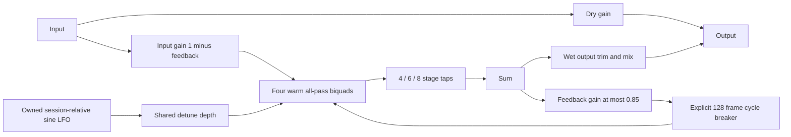
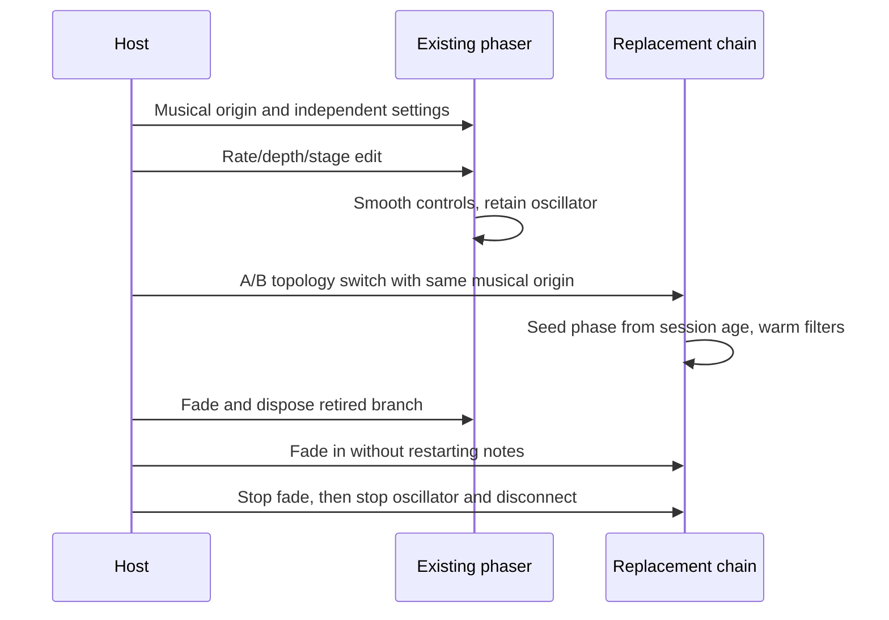
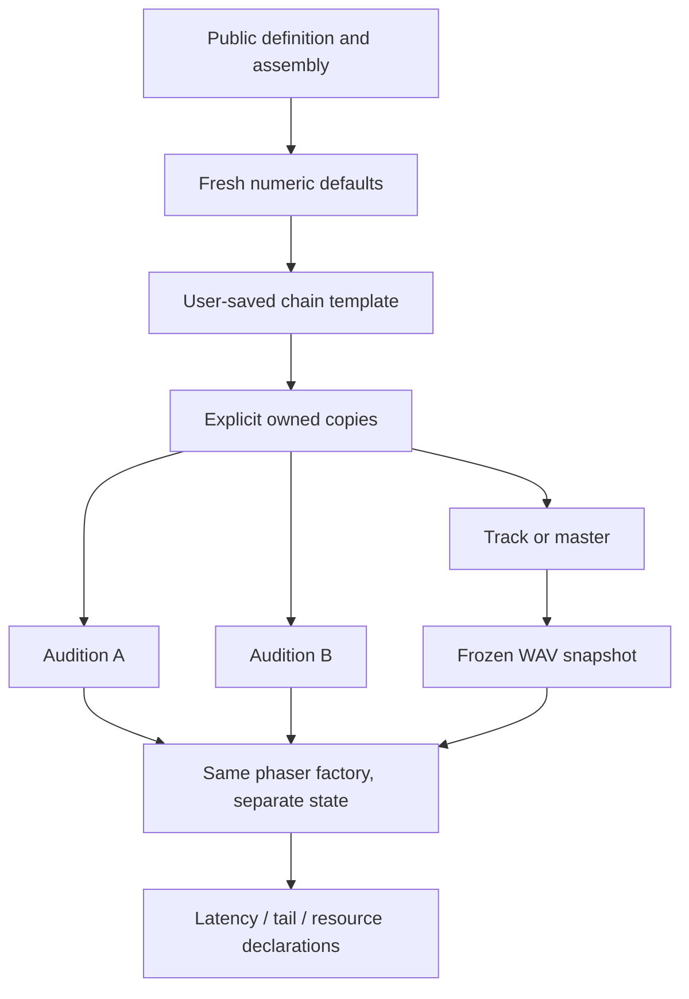

# Phaser module — v0.40.0

The phaser uses the normal M2 contract and explicit assembly entry. Equipment, placement/cables, inspector/dials, validation, owned presets, A/B, track/master processing and WAV export discover it without a new effect switch. Its stable ID is `fourpataka:pedal/phaser`, API1/data1. Project schema5 and existing projects are unchanged; older applications preserve an unavailable phaser through the existing module envelope rather than substituting another effect.

## Controls and signal model

Rate is0.05–5Hz (default0.5); depth0–100% (65); requested center100–4000Hz (800); stages exactly4/6/8 (6); feedback0–85% (25); wet trim−24…+12dB (0); mix0–100% (50). All controls are continuous, including a smoothed stage selector. Four compact dials fit per row; exact stage values use a select, with the normal range/dial keyboard controls retained. Reset creates fresh defaults in one undo operation. Phaser uses the theme's tertiary color.

Each Web Audio all-pass biquad at Q0.5 represents two coincident first-order stages. Four filters remain warm, with smoothed taps after filters2/3/4 selecting4/6/8 stages. Selection does not rebuild the graph or restart its LFO. At mix50%, dry and phase-shifted signals cancel at moving notch frequencies. At100% wet without feedback, steady-state magnitude is unity; the phase still changes. Initial transient/processed peaks may exceed input peaks; there is no hidden peak normalization or limiter.

For fixed controls, let A be the selected all-pass transfer, g the feedback fraction and D the128-frame recirculation delay. The processed transfer is `(1-g) A / (1-g D A)`. Scaling input by1−g bounds static resonance gain while changing its color; output trim remains separate. This fixed-coefficient argument is not a proof for every time-varying coefficient sequence: real rendered extreme-rate/feedback/center/depth cases test finite output and decay separately.

Mix uses `(1-m) × input + m × dbGain(output) × processed`, with m=mix/100. Pedal/whole-chain bypass smooths to dry unity. The warm wet path can retain inaudible history and reappear if unbypassed; this is a dry bypass, not a delay-style drain. Stop fades the session and then stops/disconnects every owned oscillator/node, including retired A/B branches.

## Modulation, timing and low-rate bounds

Depth maps to a detune radius of12 cents per percentage point:100% gives±1200cents, one octave each side. The effective center is clamped to `max(40, min(requestedCenter, 0.2 × sampleRate))`. Thus even the largest sweep remains between20Hz and0.4×sampleRate. Reserving a Nyquist guard band also avoids near-Nyquist all-pass poles with unexpectedly long settling at low sample rates. The displayed center is the requested setting; supported-rate clamping is a documented processing limit. Initial supported rates are3–192kHz; normal44.1/48kHz center settings are unaffected.

All phasers in a score use one musical time origin. Optional `PedalEnvironment.timeOrigin` is context seconds: live uses session.start, offline uses0. Initial creation at the future origin starts sine phase0. A late-created branch starts at the current context time with sine/cosine periodic-wave coefficients rotated by `2π × currentRate × (start − origin)`. Existing oscillators retain integrated phase during smoothed rate edits. Newly built branches seed the current-rate timeline; they do not replay historical rate-edit gestures or serialize running state.

Ordinary audition topology/cable edits retain the existing queued-until-replay policy. Explicit A/B switches can warm/crossfade a replacement. Score parameter edits stay frozen until replay, with existing live bypass behavior. No new transport, timer, worker, native privilege or persisted LFO state is introduced.

The feedback graph contributes128/sampleRate seconds of recirculation in the supported Chromium/Electron renderers. Its explicit DelayNode requests0s; an independently rendered impulse proves that requesting128 samples would instead produce256 samples. This measured quantum affects only feedback recirculation. Frequency-dependent all-pass phase is intentional coloration. Both are distinct from host look-ahead/track alignment: declared processing latency is0.

## Tail and resource accounting

Runtime tail uses actual sample rate and requested frequency/feedback; default48kHz settings budget0.2s. Export uses the slowest supported3kHz bound so preflight cannot underestimate a later sample-rate choice; default settings budget0.5s. The bounded maximum is6s for the lowest center and highest feedback. All eight warm stages are budgeted even when fewer are selected. Historical runtime budgets are not shortened by live edits.

The estimate reserves12 times the maximum low-frequency group-delay bound, plus the feedback repeat count to−80dB including128/sampleRate seconds per recirculation, plus30ms, rounded up to100ms. Numeric tail fixtures include default settings, slow/fast sweeps, low/high centers, maximum feedback and output trim at3/44.1/48/192kHz. This is a conservative, tested cleanup/export allowance, not a promised audible decay length or a general formal stability result. Shorter selected WAV tail budgets retain the host's truncation warning and end fade. Each phaser declares18 owned nodes and128KiB estimated state; native engine allocation/CPU remains device-dependent.

## Additive public contracts

`NumericParameter.choices?: readonly number[]` declares2–32 finite, strictly increasing exact alternatives within bounds, including the default. Metadata owns a frozen copy. Imports reject values outside the choices; ordinary parameters still preserve valid fractional values regardless of step. Pedal interaction clamps choices to the nearest alternative (ties choose the lower value). The inspector renders choices as an exact select. Contributors relying on choices or timeOrigin need hostv0.40.0+; the numeric API version remains1 because these fields are optional and existing definitions are unchanged.

`createMixedProcessor` now stops owned scheduled sources during normal disposal and setup/update failure cleanup, then disconnects nodes. Register the LFO with `own`; do not add an untracked timer or leave it running after disconnect. Disposal remains idempotent. Built-in reserved IDs and legacy aliases are distinct: phaser is a built-in without a legacy kind, so it creates no synthetic `undefined` alias.

## Verification

`tests/unit/phaser.test.ts` covers choices, malformed settings, defaults/copy isolation, unchanged legacy aliases and saved processing. Browser proofs cover independent bilinear notch locations, modulation, finite/decaying extreme feedback, late-created phase and one-stop disposal. Host integration proves same-clock live edits, queued topology versus A/B replacement, delayed Stop cleanup and frozen WAV equality against a direct processor path at44.1/48kHz. Board/native workflows exercise real drags/cables, exact choices, dials, preset/Apply isolation, reset/undo, reload and native JSON. Actual release results are recorded in IMPLEMENTATION_STATUS.md; physical listening, device CPU and broad accessibility remain separate checks. Chorus and reverb remain planned.
