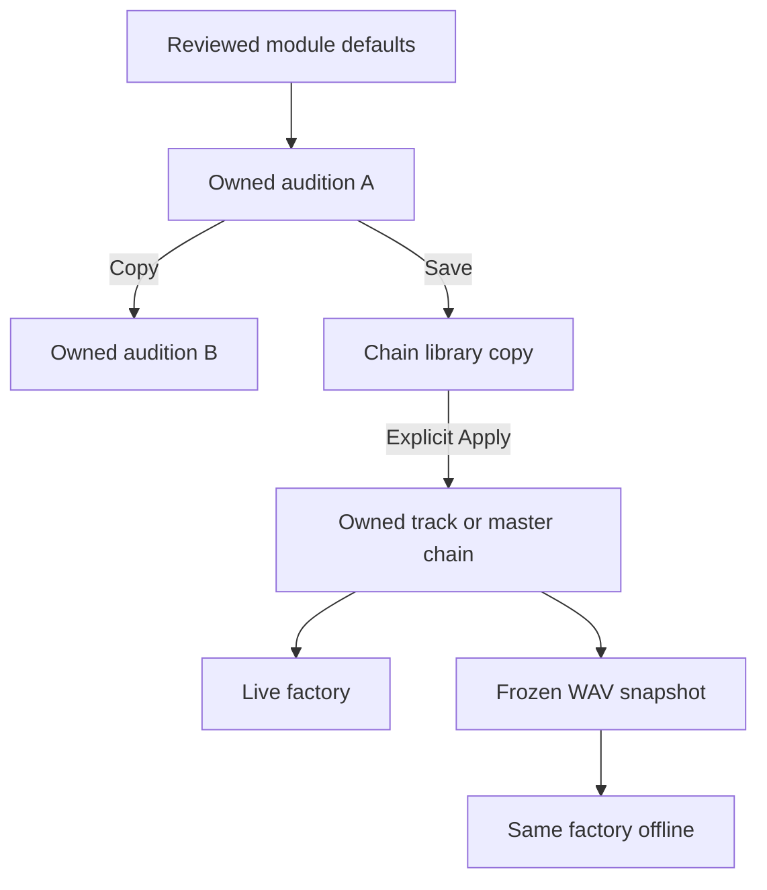
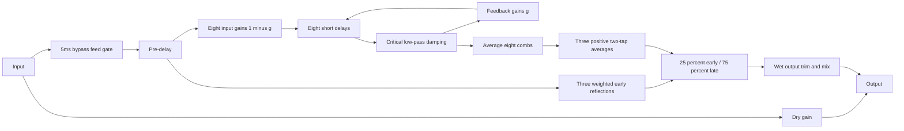
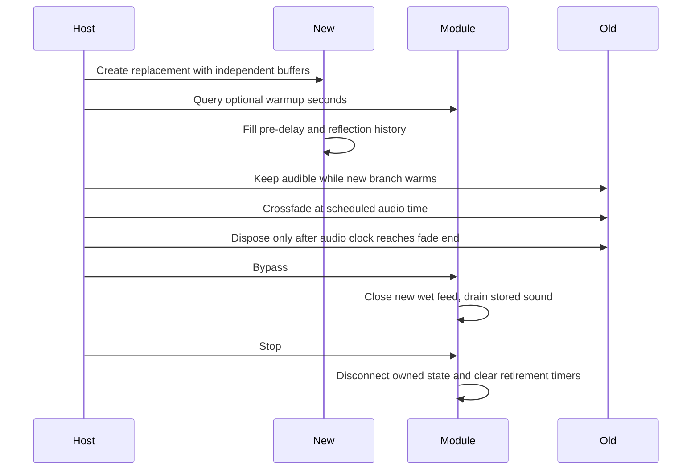

# Reverb pedal — v0.43.0

The space reverb is a source-reviewed M2 module, `fourpataka:pedal/reverb`, API1/data1. It uses generated early reflections, a damped late field and feedforward diffusion. No IR files, convolution assets, external services or added noise are required. It processes the assigned audition/track/master chain; the instrument-owned [tiny chamber](INSTRUMENT_ACOUSTICS.md) remains a separate stage before track pedals. Both may coexist.

## Controls and ownership

Pre-delay is0–100ms (default15); decay0.1–10s (1.5); size50–200% (100); damping500–18000Hz (6500); wet output−24…+12dB (0); mix0–100% (25). Size scales reflection spacing, not physical metres. Decay is a conservative low-frequency −60dB target, not an exact measured RT60 at every frequency. Damping is the late-field low-pass cutoff, limited to0.2×sampleRate. Reset restores owned defaults in one undo step; the small dials and inspector retain exact values and keyboard control. The pedal uses the theme's secondary color.

Library, audition A/B, track and master settings are independent copies. Save does not silently replace applied chains. Explicit Apply copies settings and cable routing; project history/import/reload use the existing M2 envelope. Schema6, instrument source data and the authored demo remain unchanged. Older hosts preserve an unavailable reverb envelope and block affected processing through the existing recovery contract. No effect is enabled by migration.

## Signal model and stability

[reverb.ts](../../src/modules/pedals/reverb.ts) registers through [assembly](../../src/modules/assembly.ts), with no new pedal-kind switch in the host. The wet path is:

Early delays are3.7/7.1/11.3ms times size, weighted0.5/0.3/0.2 within the25% early share. Late comb delays are29.7/37.1/41.1/43.7/53.1/59.3/67.7/71.9ms times size. Each receives `(1-g) × input`, and its filtered output recirculates through gain `g`. Their outputs average with gain1/8. Three diffusion sections average their direct and delayed input with gain0.5, using4.7/6.1/8.3ms times size. Positive averaging spreads arrivals without an all-pass transient gain boost. The early/late blend has unity DC; frequency-dependent coloration and cancellation are intentional. No peak normalization or limiter is hidden in the factory.

For delay `d`, cutoff `f` and decay target `T`, in seconds/Hz, `g = 0.001 ** ((d + 128/sampleRate + 2/(PI*f))/T)`. The cycle quantum and filter group-delay guard make the nominal decay conservative. Low-pass Q is encoded as `20*log10(0.5)` dB, giving linear Q0.5; the0.2Fs cutoff limit keeps real, nonnegative poles. Static feedback stays below1 and normalized input/averaging bounds the static gain. Time-varying edits are tested separately rather than treating this static argument as a proof for every automation sequence.

Delay/filter/feed/feedback targets share one audio timestamp and15ms smoothing. The `(1-g)` feed and `g` feedback remain complementary during interpolation. Wet histories have explicit two-channel layouts before rendering, preventing inferred mono feedback state from contaminating stereo. Channels are independent: anti-phase stereo retains energy, and a silent channel stays silent. Mono upmix/downmix remains compatible; no stereo widening or surround processing is implied.

Mix is linear: `(1-m)*dry + m*dbGain(output)*processed`. Full-wet trim may intentionally raise peaks; leave source headroom and inspect WAV clipping. Supported rates are3–192kHz. Declared state is53 owned nodes and3MiB per pedal, covering stereo buffers at the maximum rate. All nodes are disconnected once on disposal, including repeated Stop/dispose calls. Reflection/pre-delay timing is musical coloration: alignment latency is0.

## Bypass, tails and clock continuity

Bypass restores dry unity while closing new wet input over a finite5ms ramp. Existing pre-delay/reflection/feedback state drains, with a brief dry-plus-wet overlap. Stop uses the host fade then disconnects the entire graph; replay begins with empty state. The conservative budget is `preDelay/1000 + 2*decay + 0.5` seconds:3.515s by default,20.6s at the maximum. This is a tested inaudible-tail budget, not mathematical sample-exact silence from asymptotic feedback.

Runtime budgets never shrink after longer settings were used. A genuine room/decay/damping edit during a bypass drain may extend its deadline; identical host updates cannot renew it forever. Tail activity describes the scheduled conservative bypass-drain window, not a measured RMS level. Export uses the frozen current settings, adds serial instrument/track/master tails, accounts for resources and warns/fades when its effect-tail cap truncates them. For example, a chamber and reverb need their combined allowance.

M2 adds optional `warmup(params, environment)` metadata, defaulting to0 for existing contributions. It returns seconds and is validated through the host's finite seconds guard. Serial warm-ups sum. Reverb returns pre-delay plus maximum late/diffusion spacing, one render quantum and a10ms guard; dry mix/bypass need none. This only delays exposure of a replacement audition branch. It does not move score events, pad exported audio, change reported latency or restart source voices. Retirement follows AudioContext time, so device suspension cannot remove the old branch before its crossfade. Saved files contain parameters, not warm-up clocks or buffers.

Continuous audition edits retain graph/clock state. Explicit topology/A-B changes warm and crossfade independent paths. Score parameter edits keep the existing frozen-until-replay policy; live bypass remains supported. Instrument source phase, raw Fourier views, source descriptors and library copies remain under their existing authorities.

## Contributor verification

Start with [the module](../../src/modules/pedals/reverb.ts), [pedal contract](PEDAL_MODULES.md) and [mixed-processor helper](../../src/modules/foundation/processor.ts). A different room topology must preserve owned cleanup, units, resource/latency/tail declarations, stereo behavior and live/offline parity. Change saved semantics with an explicit data-version migration rather than silently reinterpreting old values.

Tests cover units/validation/copy/import ownership; exact dry/bypass identity; independent first-reflection timing/weight; silent and anti-phase stereo; finite default/extreme output and tail residuals at3/44.1/48/192kHz; decay/damping effects; rapid edits; bypass deadline extension/nonrenewal; exact node cleanup; serial warm-up and device suspension; same-clock source retention; frozen WAV parity with and without instrument acoustics at44.1/48kHz; actual board drag/cables/dials/reset/undo/reload; and native Listen/Stop, JSON and WAV. The Equipment menu scrolls locally as contributions grow. UI tail labels describe effects generally.

Executed results and release hashes belong in [implementation status](../../IMPLEMENTATION_STATUS.md). Physical listening, other devices, screen readers and room realism remain separate gates; numeric graphs are not perceptual-fidelity evidence.
