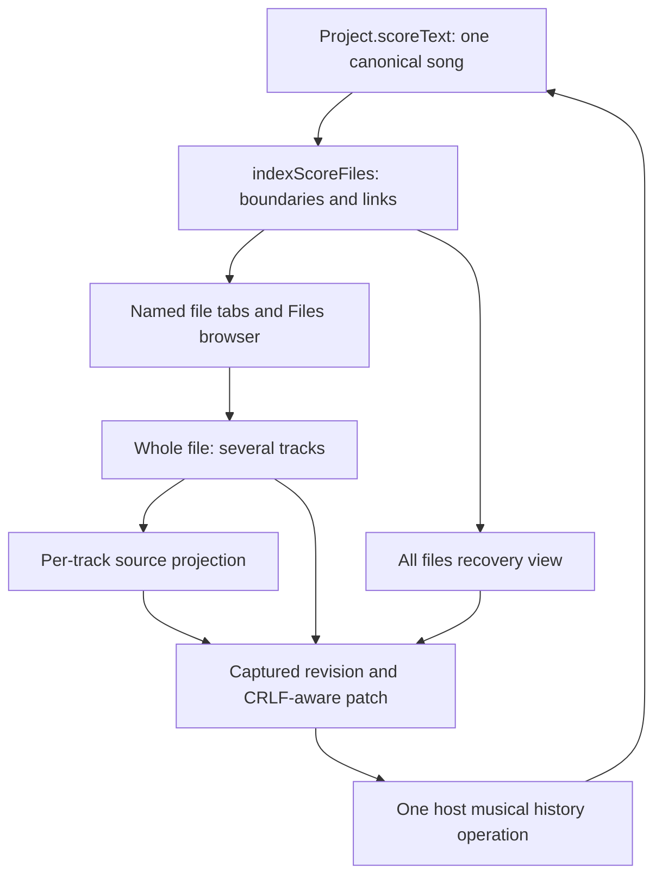
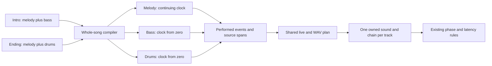
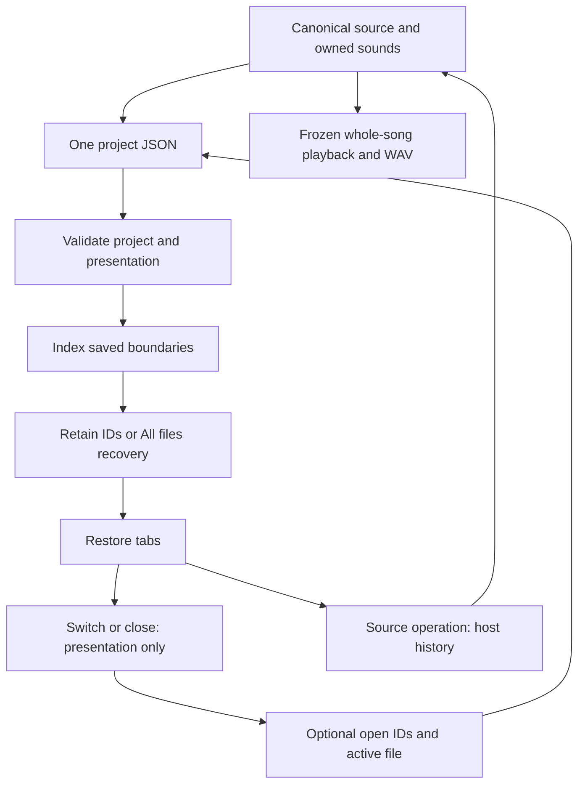

# Virtual song files and contributor services

Implemented in v0.28.0. File tabs organize one song into named virtual files above the Compose IDE. They save together in the existing project JSON. These are current source services, not the planned M5 plugin SDK or a physical filesystem.

## Writing and opening files

Use **New score file** (+) to create a file and **Files** to reopen, rename or delete it. A new file contains `from song <key>`; first creation links the existing score without replacing its music. File names are independent of the song key. Closing hides a view and keeps its music. Deleting removes its music and is undoable. A legacy score appears as `score.fourier` and is not rewritten simply by opening the app.

Each file may contain several complete track blocks. **Whole file** edits all of them; smaller track tabs project individual blocks. **All files** exposes canonical text for boundary repair. File selection never decides which tracks play. Play, comparison and WAV use the whole song. Edits to a running score are heard on replay.

Create `intro.fourier` with:

```text
from song Study
tempo 120
time 4/4
track melody using sine {
  section A {
    C4 quarter
    D4 quarter
  }
  play A
}
track bass using softBass {
  C2 whole
}
```

Then create `ending.fourier` with:

```text
from song Study
track melody using sine {
  play A
  E4 half
}
track drums using kick {
  C2 quarter
  rest quarter
  C2 quarter
  rest quarter
}
```

Melody lasts six quarter beats: two in the intro followed by four in the ending. Bass and drums start at zero and last four beats. Files organize source, rather than imply chronological sections. Use rests to position a distinct track later. Matching keys extend the same clock in canonical file order; reopening tabs in a different order does not change music order. Sections remain track-scoped: melody's A is callable from its other files, but another track cannot use it. Declarations do not play.

All files use the same case-sensitive song key: letter first, then letters/digits/underscore, at most100 characters. `from song` is the first non-comment command. Tempo, initial meter and master routing remain unique globally; scheduled meter changes govern all files. Matching track parts must agree on instrument and chain keys. Conflicts diagnose rather than replacing sound mid-track. Assignment helpers update all matching headers as one operation.

## Source authority and boundaries

`Project.scoreText` remains the only musical source. Reserved comments encode stable IDs and names; these appear in All files and are excluded from individual views:

```text
// @fourpataka-file {"id":"main","name":"intro.fourier"}
from song Study
// music here
// @fourpataka-file {"id":"ending","name":"ending.fourier"}
from song Study
// music here
```

Local edits cannot introduce reserved boundaries; use file operations or All files. Names have1–100 characters, are unique case-insensitively and exclude path separators/control characters and `.`/`..`. Limits are32 files and128 distinct logical tracks. Metadata grants no OS paths, import execution or renderer filesystem privileges.



`scoreFiles.ts` indexes original zero-based UTF-16 positions with exclusive ends and one-based lines. `markerFrom` begins a boundary, `from` its editable body, `to` the next boundary or source end, and `firstLine` the body's canonical first line. Structural `problem` requires All files recovery; link diagnostics leave valid projections editable. Preserve malformed source rather than replacing it with an empty score. Diagnostics identify the actual command after leading comments.

`projectScoreView` converts CRLF spans to CodeMirror's LF document and restores newline style on edit. File/track views share this conversion for navigation, chord previews, diagnostics and playing lines. Event file IDs identify definitions; section calls separately identify their caller's file. Inspector filenames/local lines follow the frozen performed revision during playback.

## Compilation and ownership

The lexer emits file-boundary and song-link tokens with original locations. Track/phrase blocks must close before a boundary. The compiler merges matching keys into one `ScoreTrack`, retaining its exact rational clock and `parts` with file/header/assignment spans. Repeated keys inside one file remain errors. Different keys are parallel. Compile the whole source; do not concatenate separately rendered file buffers or reset clocks on tab switches.



Reconciliation creates one applied sound per logical track; library templates remain independent. Adding/removing a same-key part preserves that sound. Explicitly removing its last part removes ownership; undo restores it. Guarded Rename track updates every matching header and transfers ownership once. Manually changing one header key can split off a new track without stealing the surviving original's sound. Invalid music must not erase independently edited copies.

Completion/navigation use the whole section index. Track Maker and event insertion target the selected file. Reference selectors include only tracks with a part there and display its filename. An empty file needs a track before event insertion. Global commands retain song-wide scope; using/routing helpers update every matching header.

## Persistence and history

Optional `Project.scoreWorkspace` stores only `{ openFiles: string[], activeFile: string | null }`; null selects All files. It contains no music/sounds. Import validates shape/bounds, drops stale IDs and exposes malformed boundaries in All files. Autosave/recovery/browser JSON/native save/open preserve source and tab state in one project file. Schema2 remains current; legacy music and owned sounds are preserved.



Selection/closing creates no musical undo entry and preserves redo. Note undo keeps selection when the file-ID set survives. Creation/deletion undo restores historical tab state because IDs changed. Rename keeps the ID stable. Stale forms/edits reject rather than overwrite newer revisions. Cursor/scroll are remembered per file/track while the workspace is mounted; only open/active file state persists on reopen.

## Contributor recipe and proof

Start with `src/core/scoreFiles.ts` for pure index/CRUD/presentation, `scoreLexer.ts`/`parser.ts` for grammar/clocks/provenance, `scoreWorkspace.ts` for projections/shared-track operations and `scoreTools.ts` for insertion. `project.ts` owns import/reconciliation. `ScoreFileTabs.tsx`, `ScoreWorkspace.tsx`, `ScoreEditor.tsx` and `App.tsx` integrate host history/completion/selection. Update these seams together: a tab or lexer token alone does not implement playback.

Keep shared scheduler/voice factories. File organization adds no engine, envelope, phase origin, seconds-based latency policy or filesystem bridge. Section/repeat work budgets remain song-wide, not renewed per file. General registries, missing-module compatibility, runtime loading and M1–M6 publication gates remain planned.

Run `npm test`, `npm run build`, affected Playwright file/workspace/section/IDE/reference/export checks and packaged native JSON/WAV workflows. Cover legacy/custom music;32-file limits; malformed links; duplicate keys/conflicting assignments; continuing clocks/parallel tracks; cross-file definitions and CRLF spans; source guards/history/owned copies; closed/reopened tabs; selected-file insertion; keyboard/narrow layouts and one-file round trips. Compare linked-file WAV with flattened music at44.1/48 kHz and verify nonzero audio from later files. Refresh the knowledge map before committing.

See [score views](SCORE_VIEWS.md), [named sections](NAMED_SECTIONS.md), [module creation](MODULE_CREATION.md) and [feature-module plans](FEATURE_MODULES.md).
