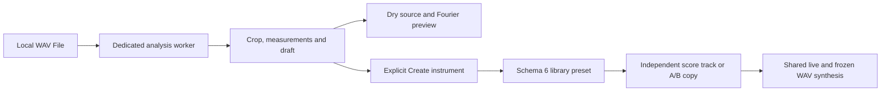
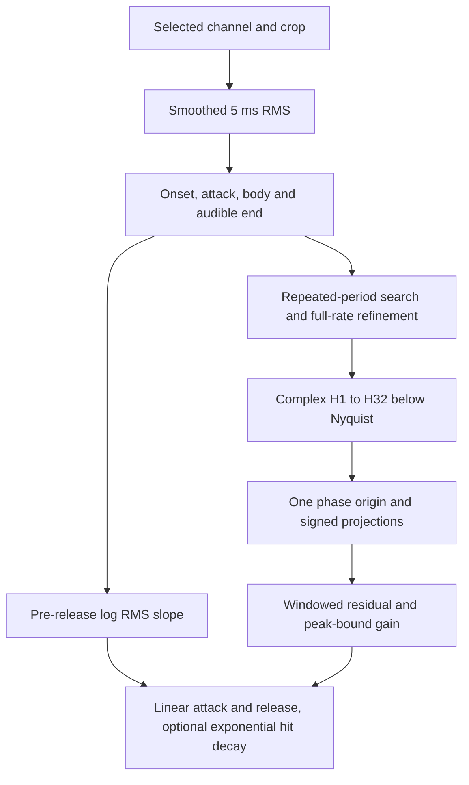

# WAV to instrument

Choose **Static harmonics (W1)** for a single signed Fourier profile. To capture evolving timbre and unpitched hits, choose **Evolving spectrum (W2)**. [W2 guide](EVOLVING_SPECTRUM.md)

In the Instrument Library, choose **Import WAV** and open a local recording of a single pitched note. The upper plot shows the recording and crop. The lower plot shows the crop, the detected timing markers and the shaded analysis body. Move the crop to isolate a note, then choose **Analyze selection**. For a stereo recording, try Left or Right if the mono mix loses energy.

Crop start and end use seconds from the start of the file. Onset, body start/end and note-off use seconds from the start of the crop. Leave pitch blank for automatic estimation or enter a frequency in Hz. The nearest note shown is a preview reference. A score still chooses the instrument's playback pitch per note.

Compare **Play original** with **Play reconstruction**. Match RMS is on by default and attenuates the louder preview. Edit attack, release, trim, hit decay when available, or the signed H1–H32 coefficients. Changing analysis settings requires a fresh fit. Reanalysis replaces the draft coefficient and timing edits. Enter an instrument name, unique score key and optional folder, then select **Create instrument**. This makes one undoable library edit. Select the preset to load a copy into the active Instrument editor, or use its key in a score.

```text
tempo 120
track melody using sampledNote {
  A3 half
}
```

## Ownership and bounds



The worker reads little-endian RIFF WAV with PCM8/16/24/32 or float32 samples, including valid PCM/float WAVE_FORMAT_EXTENSIBLE headers. It accepts one or two channels, 8–96 kHz, at most 32 MiB and 30 seconds, and a crop of at most 8 seconds. It rejects invalid alignment, truncation, non-finite samples and oversized input. Only the bounded mono crop, min/max overview bins and measurements return to the renderer. File replacement, cancellation and dialog teardown terminate the worker. The preview owns a separate audio context and honors the monitor volume. The original file, path, pitch reference and review measurements live only in the dialog. A saved preset owns ordinary Fourier parameters, so import, Compose and WAV export work without the recording.

## Fit and playback



- Pitch uses a normalized squared difference over overlapping periods, first on box-averaged samples and then with a fractional lag on the original samples. The first convincing valley avoids common suboctave picks. Repeatability describes the estimated period. A weak fundamental or a competing pitch can still make the reference octave ambiguous. Manual pitch overrides the choice.
- The fit uses a 35–500 ms body window containing at least three cycles. A Hann taper reduces leakage. At each harmonic below source Nyquist, complex projections measure magnitude and phase. One common time shift rotates harmonic `h` by `h * theta`; its projection on that signed sine axis becomes the coefficient. Relative signs matter. Two origins separated by half a cycle can give equivalent fits with different odd-harmonic signs.
- The displayed captured energy is the weighted reduction in body error before playback scaling and draft edits. The harmonic series measurement includes the quadrature energy discarded by the signed fit. DC, off-series energy and partials beyond H32 contribute to the residual. The model cannot split voices or follow changing spectra. Silence, short windows and unpitched noise can prevent a usable fit.
- The smoothed RMS envelope gives attack and audible-end estimates. With a note-off marker, the current voice ramps linearly from that point to zero over the estimated release. With unknown note-off, the preview gates through the measured end and uses 60 ms release. A well-supported pre-release exponential slope can set the existing Fourier hit decay. W1 fits pitched hits with that slope and leaves automatic noise layers and evolving spectra to follow-up work.
- Coefficients compensate for mean modeled envelope gain in the body. The fitted dry amplitude sum is capped at 0.9 before encoding separate trim and magnitudes. The draft can override these settings. The preview renders through the production Fourier voice and compares RMS over the common timeline, including padding. Both sides use attenuation only and peak headroom, including with matching off. Preview gain never changes the saved preset or exported mix.

## Verification

Synthetic fixtures cover 44.1/48 kHz, a shifted signed wave, H32, missing fundamental, linear attack and release, exponential decay, noise, DC, clipping and antiphase stereo. The browser workflow covers manual overrides, both previews, cancellation, preset ownership, undo/redo and score export. The packaged workflow saves and reopens a project, then measures the edited H2:H1 ratio in its exported WAV. Auditioning physical recordings remains a separate check.
